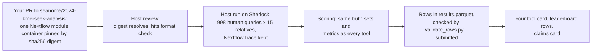

# Submitting a tool: the host runs your container

This page is for tool authors who want their tool on the leaderboard with a measured cost.
You send a container and the command that runs it. We run it on our cluster, on the same
queries and the same relatives as every other tool, and record its time and memory from the
Nextflow trace. The cost on the leaderboard is then measured the same way for every tool,
not reported by each author.



## What you send

1. **A pull request to [seanome/2024-kmerseek-analysis](https://github.com/seanome/2024-kmerseek-analysis)**
   that adds one Nextflow module for your tool. That repository's `CONTRIBUTING.md` gives the
   template (the DIAMOND module is the worked example), the output columns, and the checks the
   PR must pass. In short, the module has:
   - a container pinned by digest, `<registry>/<image>@sha256:<64 hex>`, never a tag alone;
   - the exact command, with every parameter you want run, in the module's `script:` block;
   - a hits file with one row per hit: query, target, query start and end, target start and
     end, score, and E-value or probability;
   - the tool's version, printed by the tool inside the container.
2. **Optional: a pull request to this repository** with `claims/<tool>.yaml`: your own claim,
   quoted from your paper or README, and the result on this site that would disprove it. See
   [Claims](#claims) below.

## What the host does

- Reviews the module, checks that the digest resolves, and runs the hits format check
  (`bin/check_tool_hits.py` in the analysis repository) on the mini query set.
- Runs it on Stanford's Sherlock cluster against the 998 human queries and the 15 Quest for
  Orthologs relatives, with the same truth sets (Pfam-A, Pfam-N, Swiss-Prot features) as every
  other tool. The first memory and time request comes from the measured runs of the most
  similar tool already in the traces, retries ask for double, and the peak is recorded with
  `sacct` afterwards.
- Scores the hits with the same code as every other tool, and writes the rows.

## What you get

- **Rows on the leaderboard.** Each row has your tool, its version, the container digest, the
  dataset version, the stratum, the metric, the value with its 95% interval and the number of
  truth instances `n`, the measured core-hours, peak memory and GPU-hours per 1,000 queries,
  the dollar cost at a stated price-list rate, the hardware line (for example "Stanford
  Sherlock, SLURM partition hns") and the run date. The columns are in
  [`schema/results_row.json`](schema/results_row.json); a submitted row must fill every column
  marked `submitted_required`, which `python scripts/validate_rows.py --submitted` checks. A
  score backed by fewer than 30 truth instances is shown grey. The scoring code does not yet
  compute the 95% interval, so until it does, no row passes `--submitted`.
- **A tool card**, `docs/tools/<tool>.html`: what the tool compares, what it needs, the command
  and container as run, where it is strong and weak, and its cost.
- **A failure-mode section to fill.** The card's "failure modes" list is written by you, in
  your tool's entry in [`scripts/tools.py`](scripts/tools.py) (`failure_modes`). Name the
  inputs where you expect the tool to fail; we add a test for each one we can run.
- **A claims card**, if you sent `claims/<tool>.yaml`.

## Claims

A claim file holds your claim in plain words, your own sentence quoted from your paper, README
or website with its link, and the test on this site that would disprove it. The verdict (holds,
not yet tested, disproved) is set by `scripts/claims.py` from the tables on every build; nobody
types it in. To add a quote:

```bash
python scripts/fetch_quote.py --text-url <raw page URL> --url <page a reader opens> \
    --quote "your words, under 15, exactly as on the page"
```

The script fetches the page, refuses a quote that is not on it, and prints the `author_claim`
block with the quote's sha256. Paste it into the claim. The build fails if the quote is later
edited without fetching the page again. `make quotes-online`, and the `quotes` GitHub Action
(on every change to `claims/` and weekly), fetch every page again and check that each quote is
still there, which also catches a quote reworded together with its sha256. The format is on the
[claims.yaml page](https://seanome.github.io/protein-function-annotation-leaderboard/claims-schema.html).

## Disputing a row

Open an issue on this repository naming the row (tool, setting, relative, stratum, metric) and
what you think is wrong: a parameter, the container, the hardware, or the scoring. If the module
was wrong, send a PR that fixes it. The host then:

1. reruns the module on the same queries and relatives, on the same partition, from a clean
   work directory;
2. keeps both runs: the disputed row stays in the frozen release it was published in (a
   Zenodo record cannot change), and the next release carries the rerun with its own run date;
3. writes on the card which release changed the row and why.

## Frozen releases

Each version of the tables is frozen as a Zenodo record with a DOI and mirrored to a Hugging
Face dataset, with `make release VERSION=vN` (`DRY_RUN=1` prints what it would upload and sends
nothing). Cite the version you compared against.

## The other way in

In the second path you run the tool yourself and send its predictions and a timing log in a
pull request to this repository, and a workflow scores them. That path is on the
`olgabot/contribute` branch and is not merged yet. Both paths use the same scorer. They differ
in who ran the tool, which the `cost_provenance` column of a release row records: `measured`
for a host run from the trace, `reported` for an author's timing log. The site does not yet
separate the two on its cost pages; until it does, only host-run rows carry cost.
