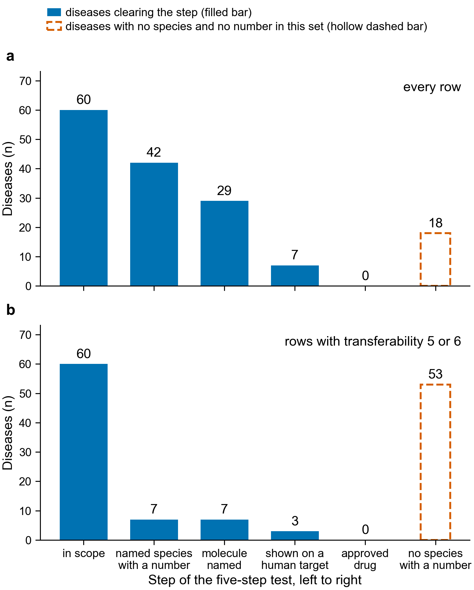

# The tolerance atlas: how many human diseases clear each of five steps

Written 2026-10-19 for Olga Botvinnik (Seanome). The belief under test: for any insult a
lineage met repeatedly over deep time, some lineage evolved a tolerance. Each disease is
checked against five steps: (1) it is in scope, (2) a named species tolerates the insult
with a measured number, (3) the molecule behind the tolerance is named, (4) that molecule
has been shown to act in a human cell, on a human receptor or in a human assay, (5) it
became an approved drug.

This first section is committed on its own, before any species search, so that git
history shows the scope list and the counting rules were fixed first.

## Scope list, fixed before any species search

`scope.csv` lists 60 diseases. A disease is in scope if it is a physical or chemical
insult that many lineages have met: a toxin or metabolite that accumulates, loss of
oxygen, freezing, drying, radiation, long immobility, injury that scars instead of
regrowing, or cancer in a large or long-lived body. No disease is added after a species
for it turns up.

| insult class | diseases |
|---|---|
| toxin | 16 (D01-D16) |
| metabolite that accumulates | 14 (D17-D30) |
| loss of oxygen | 10 (D31-D40) |
| freezing | 3 (D41-D43) |
| drying | 2 (D44-D45) |
| radiation | 2 (D46-D47) |
| long immobility | 3 (D48-D50) |
| injury that scars instead of regrowing | 9 (D51-D59) |
| cancer in a large or long-lived body | 1 (D60) |

D28 (protein aggregation) is placed under "metabolite that accumulates" because the
damaging thing is a misfolded protein that builds up. That placement is a judgement and
may be argued.

### Rows of `twenty-diseases.md` that are out of scope

These eight starting rows fail the scope rule. Their claims are still checked (they feed
the transferability back-test), in `starting-twenty.csv`, but they are not counted in
the funnel.

| row | disease | why out of scope |
|---|---|---|
| 2 | severe chronic pain | a symptom, not an insult from the list |
| 3 | hypertension | not an insult from the list |
| 4 | thrombosis (in general) | not an insult from the list; clotting during immobility is D50 |
| 5 | antibiotic-resistant infection | a pathogen that co-evolves against us |
| 7 | vaccine and biologic stability | not a human disease; drying is covered by D44 and D45 |
| 10 | autoimmune and inflammatory disease | autoimmunity |
| 17 | transplant rejection | an immune response to another person's tissue, not an insult from the list |
| 20 | ageing and healthspan | not a disease and not an insult from the list; cancer in a long-lived body is D60 |

The other twelve starting rows map to D01, D19, D22, D28, D31 and D32, D36, D42, D46,
D48, D49, D51 to D54, D60.

## Counting rules, fixed before any species search

- A row is one disease and one species. A disease with no species found gets one
  negative row: species "none found", with its PubMed queries in `queries.csv`.
- Step 2 needs a tolerance: the species withstands the insult, with a number, a unit and a
  condition from one primary paper. A species that is only the source of a molecule used
  against the disease (for example a venom peptide) does not clear step 2 by being the
  source. Such a row is kept, marked "source species, no tolerance measured", and counted
  separately.
- The funnel is nested. A disease counts at step k if at least one of its rows clears
  step 2 and every step up to k. The same counts without nesting are reported beside it.
- Transferability T (0 to 6) is scored from columns 6 and 7 only, before column 8 is
  read for that row. One point each: T1 one gene; T2 secreted; T3 catalytic or binding;
  T4 target conserved across phyla; T5 peptide or single domain; T6 works alone, no
  partner or cofactor needed. A row with no named molecule gets T = 0 with the points
  written as not scorable.
- Nature-solved-it fit N (0 to 3): N1 a named species with a measured number; N2 the
  output is a molecule; N3 a lab exists that holds the animal and runs the assay (named
  from the cited paper's affiliation).

## Rule, fixed before any species search

- The atlas supports the belief as stated if at least half of the in-scope diseases (30
  of 60) have a named species with a measured number and a citation.
- It supports the narrow version ("venoms and secretions are the only class with a drug
  record") if every row with an approved drug has T of 5 or 6, and no row with T of 2 or
  below does.
- If fewer than a quarter (15 of 60) clear step 2, the belief is a weak foundation.

---

# Results

Everything below was written after the searches, which ran on 2026-10-19. The scope list
and the rules above were committed first and were not changed.

## The funnel



Panel a counts every row. Panel b counts only rows whose transferability score is 5 or 6.
A filled blue bar is the number of diseases that clear that step and every step before it.
The hollow dashed bar on the right is the number of diseases with no species and no
measured number in that set.

| step | diseases, every row | diseases, rows with transferability 5 or 6 |
|---|---|---|
| in scope | 60 | 60 |
| a named species with a measured number | 42 | 7 |
| the molecule is named | 29 | 7 |
| the molecule shown on a human target | 7 | 3 |
| an approved drug | 0 | 0 |
| no species and no number (the negative bar) | 18 | 53 |

62 rows in all: 44 with a measured number across 42 diseases (two diseases carry two
species each), 18 negative rows. 235 PubMed queries, all in `queries.csv`, at least three
per disease.

## The rule, and what held

The rules were fixed before the searching. Here is each one and its outcome.

**The belief as stated is supported.** The rule asked for at least half of the in-scope
diseases, 30 of 60, to have a named species with a measured number and a citation. 42 of
60 do. The weak-foundation clause, fewer than 15 of 60, is far from being met.

**The narrow version cannot be tested, because no row has an approved drug.** The rule
asked whether every row with an approved drug has a transferability score of 5 or 6, and
no row with a score of 2 or below does. Step 5 asks whether the molecule from the tolerant
species became a drug. No row in the atlas has one, so the test has nothing to run on. Two
near-misses were found and both are recorded in the rows:

- Rasburicase (ELITEK, US FDA BLA 103946, approved 12 July 2002, page fetched today) is
  uricase, the enzyme humans lost. Its source is the fungus *Aspergillus flavus*, and the
  search found no animal that tolerates high urate with a measured number, so the gout row
  has no species and does not reach step 2.
- Aprepitant (EMEND, US FDA NDA 021549, approved 26 March 2003, page fetched today) blocks
  the human receptor for substance P, the molecule the naked mole rat row is about. It is a
  synthetic antagonist of that molecule's receptor, developed without reference to the
  naked mole rat, so it is not the animal's molecule made into a drug. The column reads
  "no" and says why.

**The drop is between the molecule and the human target.** 29 diseases have a named
molecule, and 7 of those have a paper showing it acting in a human cell, on a human
receptor or in a human assay. That gap, not the search for species, is where the atlas
thins out.

## What the transferability score says

Transferability was scored once, by one person, from the molecule column and the
human-target column only, before the drug column was read for that row. The six points and
the readings fixed before scoring are in `scripts/transferability.py`; every row's score is
written out in column 9 of `atlas.csv`. The five blocks of rows were collected in parallel
and each had written its own reading of the six points, so none of their scores were used.

Seven rows score 5 or 6:

| disease | species | molecule | T |
|---|---|---|---|
| organophosphate poisoning | *Culex quinquefasciatus* | acetylcholinesterase carrying G119S | 6 |
| iron overload | *Desmodus rotundus* | hepcidin, a 25-residue peptide | 6 |
| hypercapnia | *Heterocephalus glaber* | substance P, an 11-residue peptide | 6 |
| frostbite | *Tenebrio molitor* | the beetle's antifreeze protein | 5 |
| freezing in cryopreservation | *Flavobacterium frigoris* | its ice-binding protein | 5 |
| acute radiation syndrome | *Ramazzottius varieornatus* | Dsup | 5 |
| spinal cord injury | *Danio rerio* | Ctgfa, the fish form of human CCN2 | 5 |

Six of the seven are secreted proteins or peptides, which is what the score rewards. The
seventh, Dsup, works inside the nucleus and scores 5 on its other five points. Two rows,
hepcidin and substance P, give a UniProt accession for the human protein as well, because
no entry exists for the bat version of that gene; the rows say so.

## What was checked today, and what was not

Checked, by opening the source today:

- Every number in column 3 was read from the abstract of the cited paper, or from its
  PubMed Central full text where the row says so.
- Every UniProt accession in column 6 was read from the REST API today. Where no entry
  exists for the tolerant species, the row says so and gives the human or sister-species
  accession instead, marked.
- The two drug-approval pages above were fetched from Drugs@FDA today. No other approval is
  claimed anywhere in the atlas, and no other agency page was opened.
- Every PubMed query is in `queries.csv` as it was typed.

Not checked, and stated as such in the rows:

- Independent origins (column 5) is a count in only a handful of rows. Most rows say "not
  found". A few rest on a review for that count and are marked.
- The human-target column is "not found" in most rows, and no second search was run to
  rescue it.
- Several numbers are weaker than the step asks for, and each such row says so: a rate
  ratio rather than days to regrowth (limb regrowth), tooth generations at hatching rather
  than over a lifetime (tooth loss), a control value inside a toxicity study (shark urea),
  and one habitat altitude rather than a pressure measurement (llama lung).
- `Acomys spp.` in the skin-scarring row is a genus, not a binomial, because the full-text
  tool strips italic species names. It is the one row that breaks the "species are named by
  binomial" rule, and it is marked.
- Rows D02, D04, D07, D09, D13, D21 and D50 name a species or a molecule but have no
  measured number, so they count as negative rows in the funnel. The negative bar mixes
  them with rows where nothing at all was found.
- No row was checked a second time by anyone else. `VERIFY_TODO.md` lists what the second
  agent has to open.

## How the rows were collected

All 60 diseases were reached. Rows D01 to D10 were collected directly. The other five
blocks of ten were collected in parallel by five agents working from the same written
method, each writing only its own file, under the same instruction never to write an
identifier that had not come back from a tool call. Their transferability scores were
discarded and rescored here. Their numbers, citations and accessions were kept as written,
and they are what the second agent has to check.

## Files

| file | holds |
|---|---|
| `scope.csv` | the 60 in-scope diseases and their insult class, committed before any species search |
| `atlas.csv` | the eleven columns, one row per disease and species |
| `queries.csv` | every PubMed query, verbatim, with the disease it was run for |
| `counts.json` | the five counts, the negative-row count, and the same for rows with transferability 5 or 6 |
| `rows/block-*.jsonl` | what each block of ten diseases returned, before assembly |
| `funnel_tolerance_atlas_pubmed_2026-10-19.{pdf,svg,png}` | the figure |
| `VERIFY_TODO.md` | what the checking agent must open |

Rebuild everything from the row files with:

```bash
python scripts/build_tolerance_atlas.py
```

## The species, for the annotation question

These are the binomials in column 2 of rows that have a measured number. They are the input
to the next question: whether the species that tolerate a human insult have a larger share
of proteins with no functional label than model organisms do.

*Acomys cahirinus*, *Alligator mississippiensis*, *Ambystoma mexicanum*, *Anser anser*,
*Anser indicus*, *Artemia franciscana*, *Calypte anna*, *Chrysemys picta bellii*,
*Columba livia*, *Culex quinquefasciatus*, *Danaus plexippus*, *Danio rerio*,
*Deinococcus radiodurans*, *Desmodus rotundus*, *Didelphis aurita*,
*Drosophila melanogaster*, *Flavobacterium frigoris*, *Gallus gallus*,
*Heterocephalus glaber*, *Ictidomys tridecemlineatus*, *Lama glama*, *Loxodonta africana*,
*Mirounga angustirostris*, *Mya arenaria*, *Neotoma albigula*,
*Periophthalmodon schlosseri*, *Poecilia mexicana*, *Ramazzottius varieornatus*,
*Rana sylvatica* (also written *Lithobates sylvaticus*), *Squalus acanthias*,
*Tenebrio molitor*, *Urocitellus parryii*, *Ursus americanus*, *Ursus arctos horribilis*.
Plus *Acomys* spp., a genus, which cannot be used as a row.

Thirty-four binomials. Two of them are bacteria, *Deinococcus radiodurans* and
*Flavobacterium frigoris*, and two are the standard laboratory animals
*Drosophila melanogaster* and *Danio rerio*, which also sit in the model-organism group.
Decide how to handle both before running anything.

## Second-agent check

A second agent that had not read this page or the PR body opened every identifier in the
atlas on 2026-10-19 and recomputed the counts. Its report is `CHECK.md`, its row-by-row
result `check_rows.csv`, and its script `scripts/check_tolerance_atlas.py`. Nothing in
`atlas.csv` or `counts.json` was changed in response: the failures are reported here and
left standing in the table, which is what the method asks for.

| result | checks |
|---|---|
| held | 182 |
| failed | 5 |
| could not be opened | 0 |
| nothing cited in that column, so nothing to open | 185 |
| total, 62 rows by 6 checkable columns | 372 |

Every PMID, DOI, UniProt accession and agency page resolved, and each resolved to the
paper or entry the row cites. The counts came out identical: 60, 42, 29, 7, 0 with 18
negative rows, and 60, 7, 7, 3, 0 for rows scoring 5 or 6.

### The five failures

Four are the same mistake in column 7, the human target: the paper shows a human protein,
or a synthetic drug, acting in human cells, rather than the tolerant animal's own molecule
from column 6.

| row | disease | column | what the paper says |
|---|---|---|---|
| 3 | D03 cardiac glycoside poisoning | human target | The pump put into human kidney cells is the *Drosophila* sodium pump carrying the monarch's N122H change, not the *Danaus plexippus* protein in column 6. |
| 23 | D23 iron overload | human target | The paper measures bat hepcidin mRNA and compares bats with healthy people. No bat molecule acts in a human cell. |
| 27 | D27 hypercapnia | human target | The paper tests aprepitant, a synthetic antagonist, on human leukaemia cells. Naked mole-rat substance P was never put in a human cell. |
| 33 | D32 myocardial infarction | human target | The paper raises human SIRT3 in human cardiomyocytes. The ground squirrel protein was not tested. |
| 30 | D30 hypercholesterolaemia | the number | The syndecan-4 difference is in the paper, but the added sentence about no difference in plasma cholesterol between the two pigeon breeds is in neither cited paper. |

The checker left a fifth case of the same pattern, D29 hyperoxaluria, as held, because the
row says plainly that the human evidence is a trial of the whole bacterium rather than the
two enzymes in column 6. A reader who wants step 4 to mean the animal's own molecule
should drop that row too.

### What the counts become if the failed rows are dropped

| step | as published | dropping the four failed human-target rows |
|---|---|---|
| in scope | 60 | 60 |
| named species with a measured number | 42 | 42 |
| the molecule is named | 29 | 29 |
| shown on a human target | 7 | 3 |
| an approved drug | 0 | 0 |

The three that remain at step 4 are D29 hyperoxaluria, D45 severe dehydration (brine
shrimp p26 in human 293H cells) and D46 acute radiation syndrome (tardigrade Dsup in human
HEK293 cells). Dropping D29 as well leaves 2. In the transferability 5-6 restriction, step
4 falls from 3 to 1, leaving only D46. Steps 1, 2 and 3 and the drug count of 0 do not
move, because all five failures are in columns 3 and 7.

`CHECK.md` writes "D43 severe dehydration" in the sentence that lists the three survivors.
That is a slip: severe dehydration is D45, and D43 is accidental hypothermia, which has no
molecule and never reached step 4.

Two further ways of reading the method, which the checker measured rather than argued:

- Column 6 asks for a UniProt accession. Two diseases clear step 3 on a cell that names
  the protein but no accession, D05 and D42, and both say so. Requiring an accession takes
  step 3 from 29 to 27.
- Three rows clear step 2 on a weak number: D37 (a habitat altitude of 3,600 m), D49 (no
  change in muscle fibre size in seven bears, with no percentage) and D54 (a genus rather
  than a binomial). Dropping all three takes step 2 from 42 to 39.

### The rule outcome does not change

The rule asked for at least 30 of 60 diseases with a named species, a measured number and
a citation. The published count is 42, the strictest reading above gives 39, and both
clear 30. The narrow version still has nothing to run on, because no row reaches an
approved drug under any of these readings. The checker confirmed the rasburicase and
aprepitant pages and agrees that neither is the tolerant species' molecule made into a
drug.

### What the checker did not do

It did not re-run the PubMed queries, so a row that says a search returned nothing rests on
the atlas's own record. It did not check the transferability or fit scores, or the lab
affiliations behind them. Its smaller findings, eight of them, are in `CHECK.md`: rounding
in two rows, a survival figure in D28 that is relative to a control rather than an absolute
share, one claim in D49 that is not in the abstract and was not checked, and three places
where a full text was available after all.
