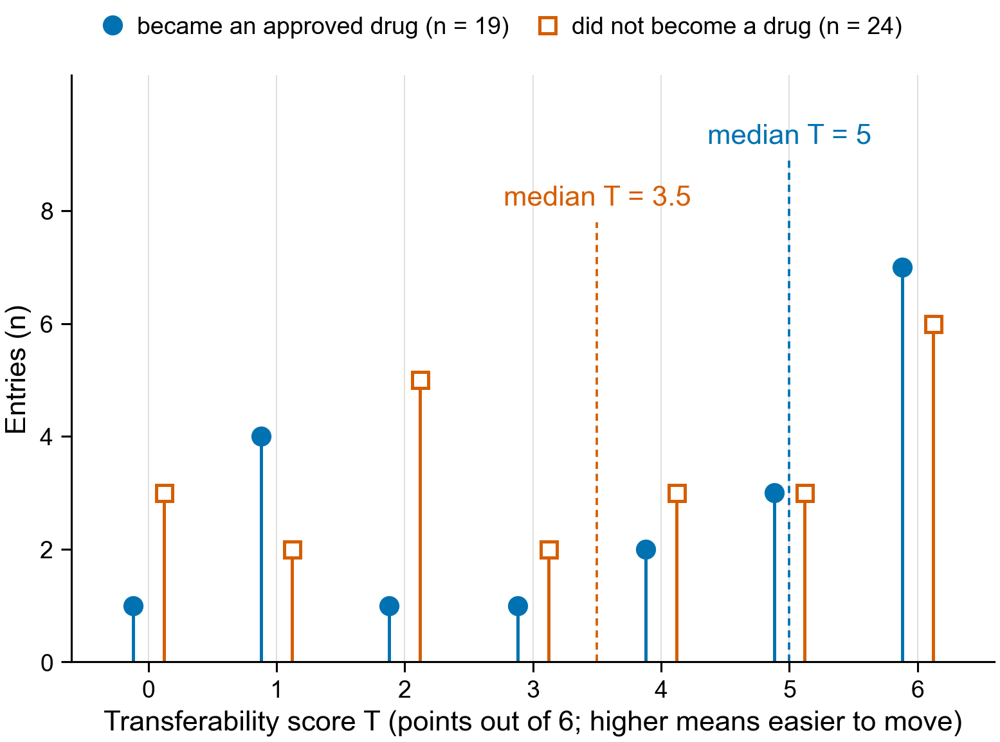

# Transferability back-test: T does not predict which animal molecules became drugs

Does the transferability score T, scored without knowing the outcome, separate
animal-derived molecules that became approved drugs from animal-derived molecules that did
not? It does not. Under the rule written before collection, T fails on two of its three
conditions, so it stays a checklist of six questions and is not used to rank programmes.

`INCLUSION.md` holds the inclusion rules and the pass/fail rule, written and committed
before any entry was collected. The sets were collected before any score existed, and the
scores were made by an agent that saw only `blind_input.csv`: an opaque id and a mechanism
description, no name and no outcome.



Each mark is the number of entries with that score. Blue filled circles are the 19 that
became approved drugs, orange open squares the 24 that did not. The two series are drawn
slightly apart at each score so neither hides the other. Higher T means the molecule
should be easier to move into a human.

## The result

| Statistic | Value | What the rule asked for |
|---|---|---|
| n, approved (Set A) | 19 | at least 15 |
| n, not approved (Set B) | 24 (15 in B(i), 9 in B(ii)) | at least 15 |
| Median T, Set A | 5 | |
| Median T, Set B | 3.5 | at least 2 points below Set A |
| Median gap | 1.5 points | fails |
| Mann-Whitney U (Set A over Set B) | 259.5 of 456 pairs | |
| p, two-sided | 0.44 | |
| p, one-sided (Set A higher) | 0.22 | |
| AUC | 0.569 | at least 0.75, fails |

The AUC is the chance that a randomly picked approved entry scores higher than a randomly
picked not-approved one, counting a tie as half. 0.5 is no information, 1 is perfect. At
0.569 the score is close to no information: of the 456 approved and not-approved pairs,
222 go the way T predicts, 75 are ties, and 159 go the other way.

Both sets clear 15 entries, so the test is not underpowered. T fails the median condition
and the AUC condition, so the rule's answer is that T does not predict approval.

## Where the small separation comes from

Set B has two kinds of entry, and they behave differently.

| Comparison | n | Median T | AUC | p, two-sided |
|---|---|---|---|---|
| Set A, approved | 19 | 5 | | |
| Set B(i), reached a trial, no approval | 15 | 5 | 0.470 | 0.78 |
| Set B(ii), named molecule, no candidate in trials | 9 | 2 | 0.734 | 0.048 |

Against the molecules that reached a clinical trial and stopped there, T is at chance
(AUC 0.470, below 0.5). The whole of the small separation comes from the nine mechanism
programmes that have a named molecule but nothing in trials, and even that comparison
sits just under the 0.75 the rule asks for.

Read plainly: T separates a molecule in hand from a mechanism described in a paper. It
does not separate a molecule that became a drug from a molecule that was tried and
failed. That is the step the score was hoped to predict.

Neither split is a verdict on its own. Set A against Set B(ii) has 9 entries on the
not-approved side, below the 15 the rule asks for, so it is underpowered; Set A against
Set B(i) has exactly 15 but is a comparison inside Set B rather than the one the rule
names. The verdict stays the pooled comparison above.

## What this means for the Idea Scoring Board

T is a checklist of six questions to ask about a molecule, and nothing more. It must not
be used to rank programmes against each other, to order a shortlist, or to argue that one
idea is more likely to reach a drug than another. The Idea Scoring Board should say so
next to the score. A high T means the molecule has the properties that make it easy to
move; it does not mean it will become a drug, and this back-test is the evidence.

## The venom, saliva and secretion count

The narrow claim, that venoms and secretions are the class with a drug record, rests on
this count: 6 of the 19 approved entries (32%) have a source material that the animal
releases outside its body, counted as venom, saliva, or another oral or skin secretion.
Those six are captopril, exenatide, ziconotide, eptifibatide, bivalirudin and desirudin.
Counting salmon calcitonin, a hormone the fish secretes into its own blood, gives 7 of 19.
Counting every approved entry whose active molecule is a peptide or protein gives 10 of 19.

Within Set A the externally secreted six have a median T of 6 against 3 for the other
thirteen, so the venom and saliva molecules are the high-T end of the approved set. They
are not the bulk of it: the other 13 approvals are tissue extracts, a sugar chain, DNA
fragments, lung surfactants and two small molecules from marine animals.

## The age gap between the sets, which was stated before the run

| Set | Year recorded | Earliest | Median | Latest |
|---|---|---|---|---|
| A | approval | 1972 | 2003 | 2016 |
| B(i) | trial start | 1994 | 2004 | 2026 |
| B(ii) | year of the paper naming the molecule | 2004 | 2013 | 2023 |

Set A is survivors and Set B is whatever could be found. Set A approvals are older than
Set B(ii) papers by about a decade at the median, which is what a survivor set looks like:
a molecule named in a 2023 paper has had no time to become a drug. The comparison that
matters least from this bias, Set A against Set B(i), is the one where T is at chance.

## Files

| File | What it holds |
|---|---|
| `INCLUSION.md` | The inclusion rules and the pass/fail rule, fixed before collection |
| `build_sets.py` | The records read on 2026-10-19, and the code that writes the CSVs |
| `sets.csv` | One row per entry, with the set, species, molecule, human target, year, agency or registry record, and citation |
| `excluded.csv` | 30 candidates checked and left out, with the reason and the record checked |
| `blind_input.csv` | Opaque id and mechanism description only, row order shuffled with seed 20261019 |
| `key.csv` | Blind id to entry, held back from the scoring agent |
| `score_blind.py`, `blind_scores.csv` | The scoring agent's script and its T1 to T6 scores with a reason for each point |
| `analyze.py` | Rejoins the scores with the outcome, runs the statistics, draws the figure |
| `scored.csv` | The rejoined table: set, entry, T1 to T6 with reasons, T, year |
| `results.json` | Every number reported here |
| `figures/` | The figure as PNG, PDF and SVG |
| `VERIFY_TODO.md` | What the checking agent re-opens and recomputes |
| `CHECK.md` | The second agent's report: records held or failed, its ten blind re-scores, its recomputed statistics |
| `check_rows.csv`, `rescore.csv` | The second agent's per-record detail and its own scores |
| `check_records.py`, `recheck.py`, `compare_scores.py`, `build_check_rows.py` | The second agent's scripts, with the raw API answers in `check_fda_raw.json` and `check_ctg_raw.json` |

## How the numbers were made

* Collection: every year, application number, trial identifier, DOI and PMID in
  `sets.csv` was read on 2026-10-19 from Drugs@FDA or an FDA label through the openFDA
  API, from ClinicalTrials.gov through its v2 API, or from the PubMed tool. Where a source
  gives no species binomial, the species column says so in the source's own words.
* Scoring: a separate agent read `blind_input.csv` and nothing else, and returned T1 to T6
  with a reason per point. No score was changed in the rejoin.
* Statistics: `scipy.stats.mannwhitneyu` for U and both p values. The AUC is U divided by
  the number of approved and not-approved pairs, computed by hand, checked by counting
  pairs directly, and checked a third time against `sklearn.metrics.roc_auc_score`. All
  three give 0.5691.
* Figure: the Nature Biotechnology style from the `publication-figures` skill, 89 mm wide,
  Arial embedded as TrueType in the PDF, PNG written with a 256-colour palette.

Rerun with:

```
/Users/olga/anaconda3/envs/2025-kmerseek-analysis/bin/python analyze.py
```

## What the scoring agent decided, in its own words

The scorer recorded these judgement calls, which the rejoin did not change:

* ice counted as a conserved target for the fish antifreeze protein;
* the two small molecules from marine animals scored a point for size;
* two antimicrobial peptides lost the "secreted" point because the description says they
  are stored inside the cell that makes them;
* cross-linked cow haemoglobin lost the "secreted" point;
* an enzyme whose size the description did not state lost the size point.

These are visible per entry in `scored.csv`, with the reason the scorer gave for each
point.

## Second-agent check

A second agent followed `VERIFY_TODO.md` without reading this page or the scores first.
Its full report is `CHECK.md`, with the per-record detail in `check_rows.csv` and its ten
blind re-scores in `rescore.csv`.

### Every record was reopened

| Verdict | Records | Which |
|---|---|---|
| Held | 43 | all 19 Set A, all 15 Set B(i), all 9 Set B(ii) |
| Failed | 0 | |
| Could not be opened | 0 records, 1 check | the European half of the "no approval" test for Set B(i) |

Every application number exists in Drugs@FDA and carries an original approval date whose
year matches the row, to the day in all 19. Every trial identifier resolves with the start
date, phase, status and intervention the row records. All nine Set B(ii) papers open and
name the molecule in that species, and a registry search for each still returns nothing.

The European Medicines Agency website answered every request with HTTP 403, so only the
FDA half of the no-approval test was opened. `INCLUSION.md` asks for neither an FDA nor an
EMA approval, so that half of the rule is checked for Set B(i) and the other half is not.

### The statistics came out identical

The checking agent recomputed everything from `scored.csv` with its own script, which does
not import `analyze.py`. Every number matches `results.json`: n 19 and 24, medians 5 and
3.5, U 259.5, p 0.4396 two-sided, AUC 0.5691 by both routes, and the two split
comparisons. The verdict is unchanged.

### Two scorers do not give the same T

This is the finding that matters for how T is used. The checking agent re-scored ten
entries from the mechanism text alone, before opening anything else:

| Agreement | Count |
|---|---|
| T totals that match exactly | 3 of 10 |
| Individual points that agree | 52 of 60 |
| By point | T1 10/10, T2 10/10, T3 9/10, T4 8/10, T5 7/10, T6 8/10 |

Most of the disagreement is T5, size: four of the eight differing points. The first scorer
gave 0 whenever the description states no residue or domain count; the second read "one
chain" as a single domain and gave the point. The rule as written does not say which is
right. T4 and T6 account for the rest: T4 mixes two different tests, how conserved the
target is and whether it is a partner of one species, and T6 is read either as "this
molecule needs no cofactor" or as "this molecule works without other proteins".

In plain words: T as written is not scored the same way twice. A one-point move on three
of six points swings a total by up to 2, which is the size of the gap the pass rule asks
for. Before anyone uses the checklist again it needs a stated rule for what to do when the
size is not known, and T4 and T6 each need to be one question instead of two.

### What the check flagged

* Batroxobin and HBOC-201 are marketed through agencies outside the FDA and the EMA. Both
  rows are correct under the rule, which looks only at those two agencies, but "did not
  become a drug" is weaker for them than for the other 13 entries in Set B(i).
* Set B(i) holds exendin(9-39), a shortened form of the same lizard peptide whose
  full-length form sits in Set A as exenatide. Under the rule they are two molecules, so
  both rows are placed correctly.
* The `year` column for Set A is the year of the application named in `record_id`, not the
  year the molecule first reached the market. Heparin and protamine were sold long before
  those dates. The `year_type` column says so and nothing downstream treats these as first
  market entry.
* Row A12 writes the binomial Ovis aries where the cited paper says only "sheep testicular
  hyaluronidase". The cell says so in its own parenthesis, but the binomial is the
  collecting agent's, not the paper's.

### Dropping the flagged rows does not change the answer

| Dropped | Median gap | AUC | Rule |
|---|---|---|---|
| nothing | 1.5 | 0.569 | fails |
| batroxobin | 2.0 | 0.574 | fails on AUC |
| HBOC-201 | 1.0 | 0.552 | fails |
| both | 1.5 | 0.556 | fails |
| exendin(9-39) | 2.0 | 0.586 | fails on AUC |

The AUC condition fails in every case, so T does not predict under any of them.

### The two split comparisons are not a verdict

The pass rule asks for at least 15 entries per set. Set A against Set B(ii) has 9 on the
not-approved side, below that, so it is underpowered and is not called either way. Set A
against Set B(i) has exactly 15, but it is a comparison within Set B rather than the
comparison the rule names. Both splits are described above because they say where the
pooled separation comes from, and neither is a result in its own right.

## Known weakness, stated before the run

Set A is survivors; Set B is whatever could be found. The sets differ in age and in how
well they are documented, and both year columns are in `sets.csv` so the gap can be read
off. Set B(ii) is the weakest part: "did not become a drug" has no registry, so those nine
entries are the ones that could be found, not a sample of anything.
