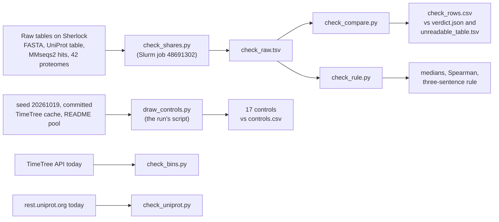

# Second-agent check of the unlabelled-share run

Written 2026-10-20 by a second Claude Code agent that did not read the README results, the PR
body or `count_unreadable.py` before getting its own numbers. Nothing in the run was changed.

## Held and failed

| Check | Result |
|---|---|
| Unlabelled share of each proteome, recounted from the raw tables | **Held, 42 of 42.** Protein count, unlabelled count, share to 2 decimals and the count named "Uncharacterized protein" all equal `verdict.json`, `unreadable_table.tsv` and each `summary.json` |
| Group medians, all proteomes | **Held.** Model 2.57, atlas 2.02, controls 6.63 (n 7, 17, 17) |
| Group medians, BUSCO of at least 90% (kingdom dataset) | **Held.** Model 2.57, atlas 1.66, controls 5.51 (n 5, 8, 4) |
| Spearman correlation of share with divergence time, within each group | **Held.** Model rho 0.27 (p 0.56), atlas 0.82 (p 0.0001), controls 0.59 (p 0.012). My own rank code and scipy agree |
| Which sentence of the rule holds | **Held: none.** See below |
| Control draw from seed 20261019 | **Held.** The run's `draw_controls.py` on the committed inputs gives the same 17 species and proteome ids, in the same order; `draw_record.json` is identical; the TimeTree cache file was not changed, so no new TimeTree read was needed |
| Each control's 100-million-year bin against TimeTree | **Held, 17 of 17.** TimeTree's `adjusted_age`, read live today, equals the cache and `controls.csv` for every control. Bins 0, 3, 4 and 6 hold 5, 5, 1 and 6 atlas species and the same numbers of controls |
| Five proteome ids against rest.uniprot.org today (release 2026_03) | **Held, 5 of 5.** Species, taxon id and UniProt's `geneCount` equal `verdict.json` |
| BUSCO C: value, four proteomes, from `short_summary` files | **Held.** *R. varieornatus* 84.8, *P. borchgrevinki* 91.1, *M. arenaria* 58.5, oyster 95.7 (metazoa_odb12) |
| CPU-hours | **Held.** 38.18 h, the sum of TotalCPU over the 85 job rows in `run_2026-10-20/sacct.txt` |
| `job_ids.txt` at the top of the run folder | **Names the wrong chain.** It lists jobs 48677882-48677888, a second submission 12 s after the jobs of record. That setup job FAILED and the rest were CANCELLED (sacct, today). The jobs of record, 48677851-48677855, are in `earlier-run-20261020T205757Z/job_ids.txt` and in `verdict.json`. The numbers are not affected |

## How the shares were recounted

`check_shares.py` was written without reading the run's count script. For each of the 42
folders in `$SCRATCH/nature-solved-it/unreadable/out/` it reads:

- the accessions in `inputs/<upid>_<taxid>.fasta.gz` (the one-protein-per-gene FASTA);
- `inputs/<upid>_uniprot.tsv.gz`: a protein has an InterPro match if any of the 13 InterPro
  or member-database columns is non-empty;
- `out/<upid>/mmseqs_vs_sprot.tsv.gz`: a protein has a Swiss-Prot hit if any row has
  `fident > 0.30`, a hit to its own entry included.

A protein is unlabelled if it has neither, as in `PLAN.md`. Every MMseqs2 query id was in
the FASTA, and every FASTA accession was in the UniProt table, for all 42 proteomes. The
script ran as Slurm job 48691302 (1 CPU, 2 min 37 s), output in `check_raw.tsv`.

## The rule

Differences in median share, percentage points:

| | atlas minus controls | atlas minus models | controls minus models |
|---|---|---|---|
| all proteomes | -4.60 | -0.55 | +4.06 |
| BUSCO of at least 90% | -3.85 | -0.91 | +2.94 |

- "The solvers are unreadable" needs atlas at least 5 points above controls at BUSCO of at
  least 90%. Atlas is 3.85 points below. Does not hold.
- "Non-model animals are unreadable" needs atlas and controls within 5 points (true) and
  both at least 5 points above models. Atlas is below models, controls are 2.94 to 4.06
  above. Does not hold.
- "The gap is assembly quality" needs a gap between groups that disappears at BUSCO of at
  least 90%, or that divergence time explains. No pair of groups differs by 5 points or
  more even before the BUSCO cut, so there is no gap for it to explain. Share does rise with
  divergence time within the atlas group (rho 0.82) and the controls (rho 0.59). A reader
  who counts that as "divergence time explains it" could call the third sentence true; under
  the rule as written there is no 5-point difference to explain, so I agree with the run's
  "none".

The atlas-minus-control value at BUSCO of at least 90% is -3.85 from the exact shares and
-3.845 from the 2-decimal shares; `verdict.json` writes -3.84. The difference is rounding.

## Things the check noticed that the rule does not ask about

- The five random controls in the 300-400 My bin are all birds (*Eurystomus gularis*,
  *Calonectris borealis*, *Phaetusa simplex*, *Cettia cetti*, *Chloropsis cyanopogon*).
  Each has an unlabelled share of 0.02-0.04% and no protein named "Uncharacterized protein",
  against 1.60-3.94% for the three atlas birds in the same bin (*Columba livia*, *Gallus
  gallus*, *Calypte anna*). Why these five
  proteomes are so fully labelled was not checked.
- Only 4 of 17 controls reach BUSCO of at least 90%, so the BUSCO-restricted control median
  rests on 4 proteomes.

## Not checked

- BUSCO values other than the four above, and the `eukaryota_odb12` values.
- The MMseqs2 and BUSCO runs themselves (not rerun); the check starts from their output.
- Whether each atlas species' reference proteome is the right one for the atlas row.

## Files

`check_shares.py`, `check_raw.tsv`, `check_compare.py`, `check_rows.csv`, `check_rule.py`,
`check_bins.py`, `check_uniprot.py`, and this file. Rerun the local steps from this folder
with `python3 -I check_compare.py`, `python check_rule.py` (needs scipy),
`python3 -I check_bins.py` and `python3 -I check_uniprot.py` (the last two read the web).
