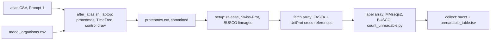

# Are the animals that solved it the ones the tools cannot read?

Prompt 3 of the "nature already solved it" tests. It asks whether species that tolerate a
human insult (the tolerance atlas of Prompt 1) have a larger share of proteins with no
function label than model organisms, and than random species at the same distance from human.

**State on 2026-10-19: set up only. No proteome has been downloaded, searched or scored.** The
atlas species list comes from Prompt 1, which is still running. Nothing has been submitted to
Sherlock.

## Why this repository

The measurement to repeat (19.41% of oyster proteins and 0.88% of human proteins unlabelled)
was made here, on branch `olgabot/why-numbers` (PR 12), by `scripts/why/labels.py` and
`scripts/why/sherlock_labels.sbatch`. This branch starts from that one, so the new run uses
the same code, the same MMseqs2 image and the same Swiss-Prot handling. Prompt 1's tolerance
atlas has its own branch in this repository (`olgabot/tolerance-atlas`).

## The measurement, and how it differs from the prompt

The unlabelled share is the leaderboard's: the share of proteins with neither an InterPro
match nor a Swiss-Prot hit above 30% identity, where a hit to the protein's own Swiss-Prot
entry counts. An InterPro match means UniProt cross-references the protein to an InterPro
entry or a member-database signature. A Swiss-Prot hit means MMseqs2 (`-s 7.5`, E ≤ 0.001)
finds a reviewed protein with identity above 0.30.

Prompt 3 describes the share as "no InterPro entry, no GO term and no named function". That
is not what the leaderboard measured. GO terms and the protein's name were not used. This run
keeps the leaderboard's definition so that every new proteome can be compared with the oyster
and human numbers. The share of proteins UniProt names "Uncharacterized protein" is recorded
in its own column.

`count_unreadable.py` was checked on the leaderboard's own files for human and oyster
(the job 47961379 MMseqs2 table and the UniProt tables downloaded on 2026-10-15). It gives
0.88% for human (181 of 20,652 proteins) and 19.41% for the oyster (5,877 of 30,272), the
leaderboard's numbers, and BUSCO completeness of 100.0% and 95.68% (BUSCO's own summary
says 100.0% and 95.7%).

## Files

| File | What it holds |
|---|---|
| `PLAN.md` | Groups, measurement, BUSCO lineage rule and pass/fail rule, committed before any data |
| `model_organisms.csv` | The seven model organisms: UniProt reference proteome, release 2026_03, TimeTree time from human, read 2026-10-19 |
| `timetree_cache.json` | Every TimeTree answer used, with its URL and the time it was read |
| `reference_proteomes_README.txt.gz` | UniProt's reference proteome list for 2026_03; the pool the controls are drawn from |
| `sacct_47961379.txt` | Slurm's record of the leaderboard job, read 2026-10-19 |
| `resources.md`, `resources_model_organisms.tsv` | CPU-hours, wall clock and memory, predicted per proteome from that record |

Added once the atlas list exists (by `after_atlas.sh`): `atlas_proteomes.csv`, `controls.csv`,
`draw_record.json`, `proteomes.tsv`, `resources_run.tsv`.

## Model organisms

| Species | Reference proteome | Proteins (README) | BUSCO lineage | Time from human (My, TimeTree adjusted) |
|---|---|---|---|---|
| *Homo sapiens* | UP000005640 | 20,652 in the FASTA (README says 147,503) | metazoa_odb12 | 0 |
| *Mus musculus* | UP000000589 | 21,860 | metazoa_odb12 | 83.5 |
| *Danio rerio* | UP000000437 | 26,567 | metazoa_odb12 | 435.1 |
| *Drosophila melanogaster* | UP000000803 | 13,814 | metazoa_odb12 | 692.2 |
| *Caenorhabditis elegans* | UP000001940 | 19,792 | metazoa_odb12 | 692.2 |
| *Saccharomyces cerevisiae* S288C | UP000002311 | 6,066 | fungi_odb12 | 1,164.3 |
| *Arabidopsis thaliana* | UP000006548 | 27,496 | viridiplantae_odb12 | 1,515.8 |

UniProt release 2026_03 (2 September 2026), read from `rest.uniprot.org/proteomes/search` on
2026-10-19. Times from `https://timetree.temple.edu/api/pairwise/9606/<taxid>`, read 2026-10-19.
The fly, the worm and the oyster share one time (692.2 My) because TimeTree dates the split of
protostomes from deuterostomes, not each lineage.

## The run

Steps on Sherlock run from `scripts/nature_solved_it/unreadable/submit_all.sh`, which submits
all four jobs in one go, chained with Slurm dependencies. Fetch task N and label task N are
paired (`aftercorr`), so a proteome is searched as soon as its own download finishes. The
collect job runs even if some label tasks fail, and lists the failures.

The oyster (UP000005408) is added to the run as a "leaderboard reference" row unless it is
already in a group. It repeats the 19.41% measurement and is labelled on the figure. It is in
no group median.

## Not done yet

- The atlas species list, the control draw, the Sherlock run, the figure, `verdict.json`, the
  notebook and the claims-ledger row.
- The second agent's recompute.
- The control draw was tested on a stand-in list of six species, labelled as such and kept
  out of the repository. Drawing twice with the same seed and TimeTree answers gave the same
  five controls.
