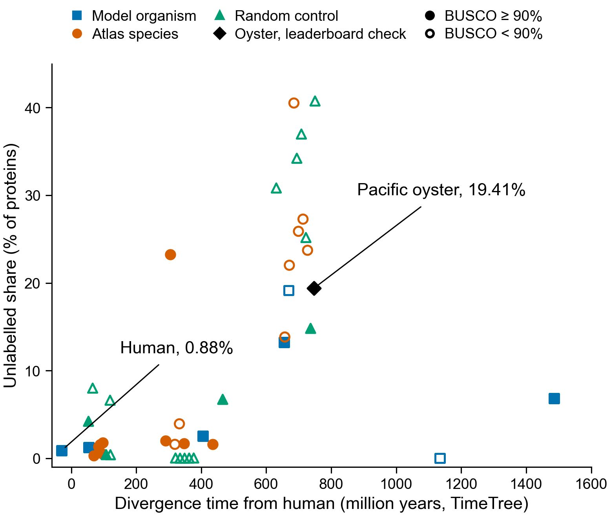
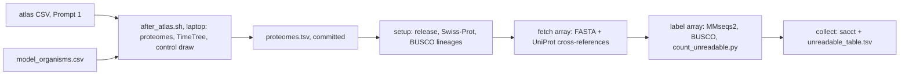

# Are the animals that solved it the ones the tools cannot read?

Prompt 3 of the "nature already solved it" tests. It asks whether species that tolerate a
human insult (the tolerance atlas of Prompt 1) have a larger share of proteins with no
function label than model organisms, and than random species at the same distance from human.

**Result, 2026-10-20: none of the three sentences in PLAN.md holds.** The atlas species are
not less readable than random species at the same distance from human; if anything they are
more readable. Among proteomes with BUSCO of at least 90%, the median unlabelled share is
1.66% for the atlas species (n = 8), 5.505% for the random controls (n = 4) and 2.57% for the
model organisms (n = 5). Over all proteomes: 2.02% (n = 17), 6.63% (n = 17) and 2.57% (n = 7).
Within the atlas and control groups the share rises with divergence time from human (Spearman
rho 0.82 and 0.59). The oyster came out at 19.41% and human at 0.88%, as on the leaderboard.
Notebook: `solvers_unreadable_uniprot_2026_03.ipynb`; numbers: `verdict.json`.

## Run of record

Sherlock, 2026-10-20, commit ce7928d: setup 48677851, download array 48677853, label array
48677854, collect 48677855 ("42 proteomes, 0 failed"). 38.18 CPU-hours in all (label tasks
38.14), against 45.7 predicted. Its small outputs (result table, Slurm record, setup marker,
versions, logs, and per proteome the counts in `summary.json`, input checksums and BUSCO
summaries) are in `run_2026-10-20/`, copied by `copy_results.sh`. The MMseqs2 tables (2 GB)
stay in `$SCRATCH/nature-solved-it/unreadable/out/`.

`submit_all.sh` was run twice, 13 s apart. The second chain's setup, 48677882, built the BUSCO
image again and failed when it tried to move it onto the first chain's finished, read-only
image; its download, label and collect jobs (48677884, 48677886, 48677888) were cancelled
and never ran. Its `job_ids.txt` replaced the first chain's; the first chain's ids are in
`run_2026-10-20/earlier-run-20261020T205757Z/job_ids.txt`. Its unfinished image is still at
`$SCRATCH/nature-solved-it/unreadable/images/busco-6.1.0--pyhdfd78af_2.sandbox.part`, for
Olga to remove. Since commit f0d03e2, `submit_all.sh` refuses while any unread-* job is
pending or running, and writes one job-id file per submission.

## Why this repository

The measurement to repeat (19.41% of oyster proteins and 0.88% of human proteins unlabelled)
was made here, on branch `olgabot/why-numbers` (PR 12), by `scripts/why/labels.py` and
`scripts/why/sherlock_labels.sbatch`. This branch starts from that one, so the new run uses
the same code, the same MMseqs2 image and the same Swiss-Prot handling. Prompt 1's tolerance
atlas has its own branch in this repository (`olgabot/tolerance-atlas`).

## The measurement, and how it differs from the prompt

The unlabelled share is the leaderboard's: the share of proteins with neither an InterPro
match nor a Swiss-Prot hit above 30% identity, where a hit to the protein's own Swiss-Prot
entry counts. An InterPro match means UniProt cross-references the protein to an InterPro
entry or a member-database signature. A Swiss-Prot hit means MMseqs2 (`-s 7.5`, E ≤ 0.001)
finds a reviewed protein with identity above 0.30.

Prompt 3 describes the share as "no InterPro entry, no GO term and no named function". That
is not what the leaderboard measured. GO terms and the protein's name were not used. This run
keeps the leaderboard's definition so that every new proteome can be compared with the oyster
and human numbers. The share of proteins UniProt names "Uncharacterized protein" is recorded
in its own column.

`count_unreadable.py` was checked on the leaderboard's own files for human and oyster
(the job 47961379 MMseqs2 table and the UniProt tables downloaded on 2026-10-15). It gives
0.88% for human (181 of 20,652 proteins) and 19.41% for the oyster (5,877 of 30,272), the
leaderboard's numbers, and BUSCO completeness of 100.0% and 95.68% (BUSCO's own summary
says 100.0% and 95.7%).

## Files

| File | What it holds |
|---|---|
| `PLAN.md` | Groups, measurement, BUSCO lineage rule and pass/fail rule, committed before any data |
| `model_organisms.csv` | The seven model organisms: UniProt reference proteome, release 2026_03, TimeTree time from human, read 2026-10-19 |
| `timetree_cache.json` | Every TimeTree answer used, with its URL and the time it was read |
| `reference_proteomes_README.txt.gz` | UniProt's reference proteome list for 2026_03; the pool the controls are drawn from |
| `sacct_47961379.txt` | Slurm's record of the leaderboard job, read 2026-10-19 |
| `resources.md`, `resources_model_organisms.tsv` | CPU-hours, wall clock and memory, predicted per proteome from that record |

Made by `after_atlas.sh` from the atlas on 2026-10-19:

| File | What it holds |
|---|---|
| `atlas_species_list.csv` | Every name in the atlas's species column, its binomial, and why it is in or out of the atlas group |
| `atlas_species_input.csv` | The 30 atlas-group binomials |
| `atlas_named_species.txt` | Every binomial named in the atlas; all are out of the control pool |
| `atlas_proteomes.csv` | The 30 atlas species and their reference proteome, where one exists (17) |
| `controls.csv`, `draw_record.json` | The 17 random controls and the record of the draw (seed, bins, skips) |
| `proteomes.tsv` | The run list: 42 proteomes |
| `resources_run.tsv` | Predicted CPU-hours and wall clock per proteome |

## The atlas group and the controls

34 binomials in the atlas have a measured number. Four are left out by PLAN.md decisions 1
and 2: *Deinococcus radiodurans* and *Flavobacterium frigoris* (bacteria), and *Danio rerio*
and *Drosophila melanogaster* (model organisms only). *Onychomys torridus* has no row with a
number and *Acomys* spp. is a genus. That leaves 30 atlas species.

17 of the 30 have a UniProt 2026_03 reference proteome. The 13 without one are *Acomys
cahirinus*, *Ambystoma mexicanum*, *Anser anser*, *Anser indicus*, *Desmodus rotundus*,
*Didelphis aurita*, *Lama glama*, *Mirounga angustirostris*, *Neotoma albigula*,
*Periophthalmodon schlosseri*, *Rana sylvatica* (UniProt: *Lithobates sylvaticus*),
*Squalus acanthias* and *Ursus arctos*. Their absence was checked against the 2026_03 reference
proteomes README as well as the UniProt search. Two species resolved to a subspecies
proteome, as decision 4 allows: *Chrysemys picta* to *C. picta bellii* and *Danaus plexippus*
to *D. plexippus plexippus*.

| 100-My bin (time from human) | Atlas species | Controls drawn |
|---|---|---|
| 0 (0 to 99 My) | 5 | 5 |
| 3 (300 to 399 My) | 5 | 5 |
| 4 (400 to 499 My) | 1 | 1 |
| 6 (600 to 699 My) | 6 | 6 |

No bin was short. The draw read 236 of the 3,501 candidates in shuffled order (seed
20261019); one had no TimeTree time. One control, *Pagothenia borchgrevinki* (bald rockcod),
may be a species with a tolerance the atlas did not list. Under the rule it is a control,
because the atlas does not name it; whether the atlas should have is a question for Prompt 1.

## Model organisms

| Species | Reference proteome | Proteins (README) | BUSCO lineage | Time from human (My, TimeTree adjusted) |
|---|---|---|---|---|
| *Homo sapiens* | UP000005640 | 20,652 in the FASTA (README says 147,503) | metazoa_odb12 | 0 |
| *Mus musculus* | UP000000589 | 21,860 | metazoa_odb12 | 83.5 |
| *Danio rerio* | UP000000437 | 26,567 | metazoa_odb12 | 435.1 |
| *Drosophila melanogaster* | UP000000803 | 13,814 | metazoa_odb12 | 692.2 |
| *Caenorhabditis elegans* | UP000001940 | 19,792 | metazoa_odb12 | 692.2 |
| *Saccharomyces cerevisiae* S288C | UP000002311 | 6,066 | fungi_odb12 | 1,164.3 |
| *Arabidopsis thaliana* | UP000006548 | 27,496 | viridiplantae_odb12 | 1,515.8 |

UniProt release 2026_03 (2 September 2026), read from `rest.uniprot.org/proteomes/search` on
2026-10-19. Times from `https://timetree.temple.edu/api/pairwise/9606/<taxid>`, read 2026-10-19.
The fly, the worm and the oyster share one time (692.2 My) because TimeTree dates the split of
protostomes from deuterostomes, not each lineage.

## The run

Steps on Sherlock run from `scripts/nature_solved_it/unreadable/submit_all.sh`, which submits
all four jobs in one go, chained with Slurm dependencies. Fetch task N and label task N are
paired (`aftercorr`), so a proteome is searched as soon as its own download finishes. The
collect job runs even if some label tasks fail, and lists the failures.

The oyster (UP000005408) is added to the run as a "leaderboard reference" row unless it is
already in a group. It repeats the 19.41% measurement and is labelled on the figure. It is in
no group median.

## First submission failed, 2026-10-20

Olga submitted the chain at commit e18c94e. Setup job 48668645 failed after 22 s with
"exec /usr/local/bin/busco failed: a shared library is likely missing in the image". The
download and label arrays were cancelled and never ran. The collect job 48668661 ran anyway
and wrote an `unreadable_table.tsv` listing all 42 proteomes as failed; that table is not a
result.

The cause: the shared BUSCO sandbox in `$SCRATCH/apptainer-cache`, the same folder that ran
BUSCO in job 47961379 on 2026-10-15, had lost `usr/lib64` and its empty folders (`tmp`,
`var/tmp` and others) on 2026-10-18 at 07:37-07:38 PDT. What removed them is not known. The
image's programs ask for `/lib64/ld-linux-x86-64.so.2`, the program loader, which lived in
`usr/lib64`, so none of them can start. Checked on a Sherlock login node on 2026-10-20:
`busco --version` in that sandbox gives the same error, `readelf` shows the loader path, and
the same Python starts (Python 3.12.13) when the loader still present elsewhere in the image is
called directly. The image is x86-64, so the platform is not the problem.

What changed:

- `setup.sbatch` builds the run's own BUSCO sandbox under `$RUN/images/` from the same image
  reference, checks that `busco --version` prints BUSCO 6.1.0 and that MMseqs2 starts, then
  makes the sandbox read-only so a clean-up cannot delete files from it. The label tasks use
  that sandbox. Setup now asks 4 CPUs, 16 GB and 3 hours for the build.
- Setup's last step writes `$RUN/setup_ok`, naming its own job id. `collect.sbatch` and
  `collect.py` refuse to write anything unless that file names this run's setup job.
- `collect` now depends on `afterok` of setup as well as `afterany` of the label array, with
  `--kill-on-invalid-dep=yes`, so it can never run after a failed setup.
- `submit_all.sh` moves an earlier run's `unreadable_table.tsv`, `sacct.txt`, `setup_ok`,
  version files, `job_ids.txt` and `out/` into `$RUN/earlier-run-<UTC time>/` before
  submitting. Nothing is deleted; the downloaded inputs are kept and reused.

## Not done yet

- The second agent's recompute (`VERIFY_TODO.md`).
