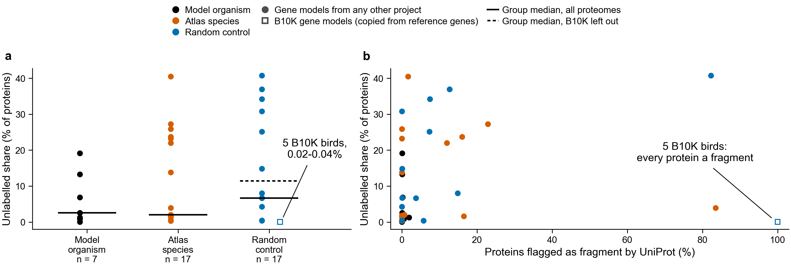

# Why five control birds have almost no unlabelled proteins

Read 2026-10-20 from UniProt REST and the run of record (`../run_2026-10-20/`). Built by
`scripts/nature_solved_it/unreadable/annotation_source.py`. PLAN.md, the rule and the
verdict are not changed; this is a sensitivity check only.

**a**, one mark per proteome, with the group median over all proteomes (solid) and with the
five B10K birds left out (dashed). **b**, the same unlabelled share against the share of the
counted proteins that UniProt flags as fragments.

## Cause

The five random-control birds at 300-400 million years (*Eurystomus gularis* UP000541249,
*Calonectris borealis* UP000535403, *Phaetusa simplex* UP000556165, *Cettia cetti*
UP000524451, *Chloropsis cyanopogon* UP000614263) all come from one project. Their UniProt
proteome records cite "Bird 10,000 Genomes (B10K) Project - Family phase", with gene models
submitted to ENA by the B10K Consortium. No other proteome in the run cites it.

The B10K paper (Feng et al. 2020, *Nature*,
https://doi.org/10.1038/s41586-020-2873-9, read today in PubMed Central PMC7759463) says
the 363 genomes were annotated with a homology-based method only, using gene models from
chicken, zebra finch and human plus published transcriptomes, with GeneWise. The Methods
describe no prediction of genes from the genome alone. A gene that does not resemble one of
those reference genes therefore cannot appear in these proteomes.

The proteins the run counted (the accessions in the run's FASTA, sha256 matched for all 42)
show the result of that method:

| Proteome | Unlabelled | Swiss-Prot hit > 30% | Named "Uncharacterized protein" | Gene symbol | Flagged fragment | BUSCO |
|---|---|---|---|---|---|---|
| *Eurystomus gularis* | 0.02% | 99.84% | 0 | 99.59% | 100% | 80.06% |
| *Calonectris borealis* | 0.02% | 99.79% | 0 | 99.54% | 100% | 76.19% |
| *Phaetusa simplex* | 0.03% | 99.80% | 0 | 99.43% | 100% | 79.17% |
| *Cettia cetti* | 0.04% | 99.73% | 0 | 99.56% | 100% | 82.89% |
| *Chloropsis cyanopogon* | 0.04% | 99.76% | 0 | 99.59% | 100% | 71.88% |

Every protein is flagged as a fragment; no other proteome of the 37 is above 84%. One example
opened today: A0A7L4CTF9 (*E. gularis*, gene Abhd6, ENA protein NXW53254.1) is coded by
exons whose first and last ends are both marked open (`<` and `>`), on a SOAPdenovo 2.04
assembly from 35x Illumina reads. The gene symbols come from the reference genes the models
were copied from.

So for these five proteomes the unlabelled share measures how the gene models were made,
not how readable the birds are: a protein copied from a known reference protein will almost
always hit Swiss-Prot.

## Sensitivity of the group medians

| Group | All proteomes | Without the five B10K birds | BUSCO ≥ 90% | BUSCO ≥ 90%, without B10K |
|---|---|---|---|---|
| Model organisms | 2.57% (n = 7) | 2.57% (7) | 2.57% (5) | 2.57% (5) |
| Atlas species | 2.02% (17) | 2.02% (17) | 1.66% (8) | 1.66% (8) |
| Random controls | 6.63% (17) | 11.42% (12) | 5.505% (4) | 5.505% (4) |
| Atlas minus controls | -4.61 | -9.40 | -3.84 | -3.84 |

- The five birds pull the control median down, from 11.42% to 6.63%. Leaving them out makes
  the controls harder to read, so the atlas sits further below them, not closer.
- All five have BUSCO below 90% (71.88-82.89%), so none is in the BUSCO ≥ 90% medians that
  sentence 1 of the rule uses. Those medians do not move.
- Without them, sentence 2 still fails: atlas and controls are 9.40 points apart (the rule
  needs within 5), and the atlas median is not 5 points above the model organisms.
- The verdict (no sentence holds) is the same with or without them.

## Other things seen in the same table, not followed up

- *Calypte anna* (atlas, 3.94% unlabelled) also has 83.46% of its proteins flagged as
  fragments and gene symbols on only 0.32%. Its proteome cites the 2014 avian comparative
  genomics paper. How those gene models were made was not checked today.
- *Oikopleura dioica* (control, 30.83% unlabelled) has no protein named "Uncharacterized
  protein": its submitter used other names. The "Uncharacterized protein" share depends on
  the submitter as well.

## Files

- `annotation_source_uniprot_2026_03.tsv`: one row per proteome, with the run's columns plus
  `annotation_source` (UniProt's genome annotation source), `first_citation`, `b10k`,
  `assembly`, `gene_symbol_pct`, `fragment_pct`, `pe_homology_pct` (protein existence
  "inferred from homology") and `sprot_hit_pct`.
- `sensitivity_without_b10k.json`: the medians above.
- The UniProt downloads (~150 MB) are not committed; the script's docstring gives the URLs.
