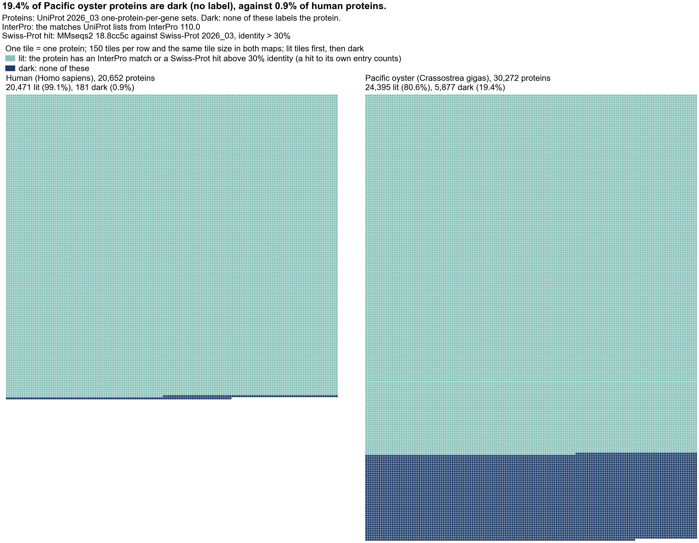
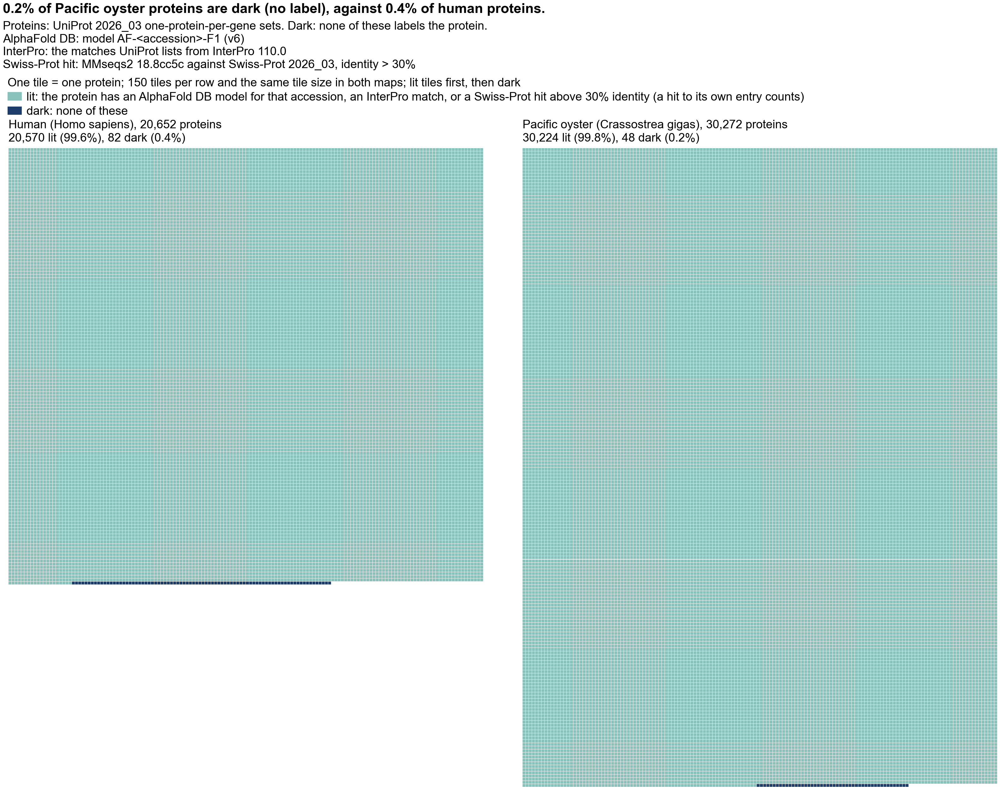
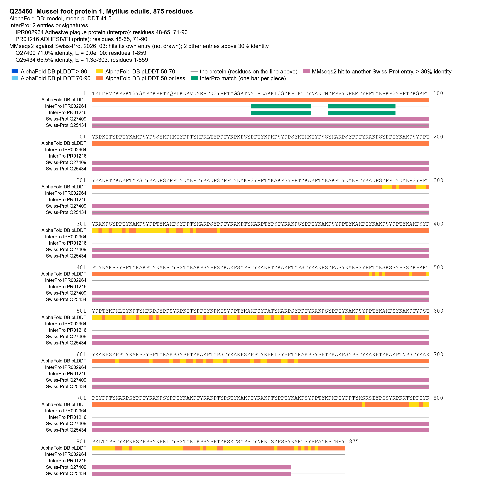
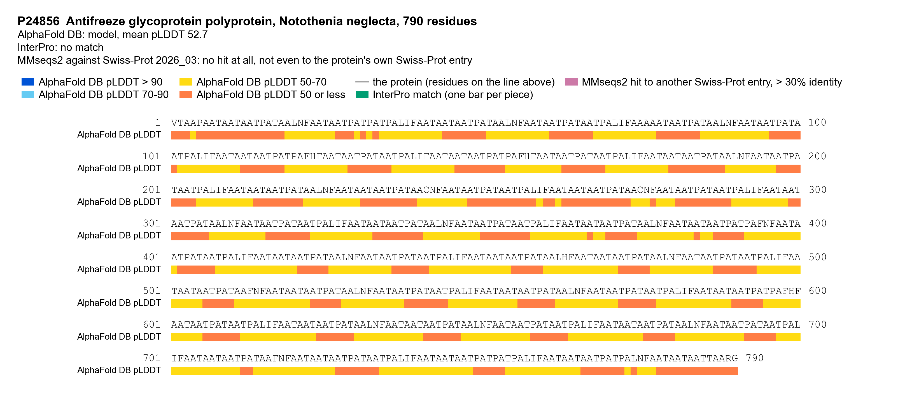
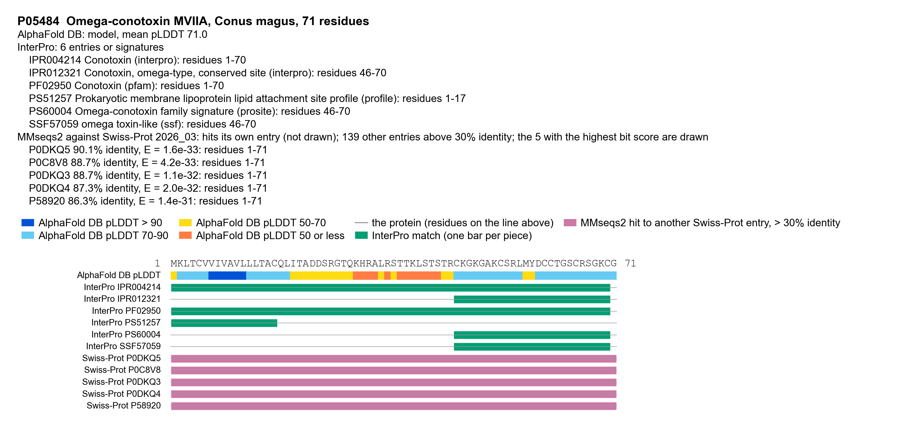
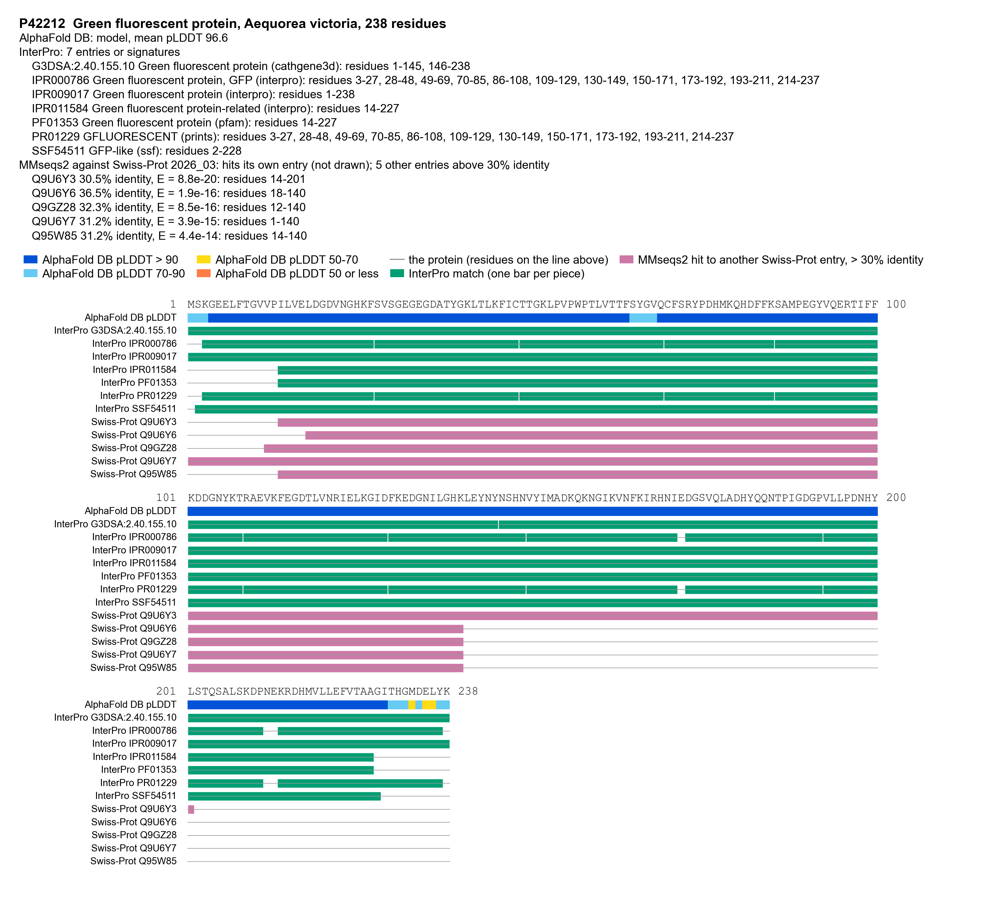

# Why this project: the numbers

Every number below was computed from a file downloaded on 2026-10-15 or made from one, and sits next to that file and its release. The table holding them is `results/why/numbers.parquet`; the files, their URLs and sha256 sums are in `results/why/sources.json`. UniProt is release 2026_03 (2 September 2026) throughout. The last column is the verdict of a second, independent recomputation (HOLDS, WRONG or UNVERIFIABLE).

## What the numbers say

- Swiss-Prot 2026_03 holds 575,748 reviewed entries from 11,770 species. The five largest organisms hold 12.00% of them.
- Animal species that the World Register of Marine Species (WoRMS) lists as marine supply 6,792 entries, 1.18% of Swiss-Prot.
- 67,060 UniProt entries from cellular life cite an experimental structure in the PDB. Counted by organism name, as the deck does, they come from 6,146 organisms, and the five largest hold 25.91%. The deck said 62,253 entries, 5,918 organisms and 26.4%.
- Of 1,534,287 described animal species (Catalogue of Life), 4,855 have a Swiss-Prot entry (0.32%).
- In the Pacific oyster, 19.41% of proteins have neither an InterPro match nor a Swiss-Prot hit above 30% identity; in human, 0.88%. Both count a hit to the protein's own Swiss-Prot entry; without it, human rises to 2.78% and oyster is 19.42%, since few oyster proteins are Swiss-Prot entries. An AlphaFold DB model for the protein's accession exists for 94.85% of oyster and 98.31% of human proteins, so with the model counted as a label only 0.16% and 0.40% have none.

## 1. Swiss-Prot by organism

| Number | Value | Unit | Source file | Release | Check |
|---|---|---|---|---|---|
| Swiss-Prot reviewed entries | 575,748 | entries | [`uniprot_sprot.dat.gz`](https://ftp.uniprot.org/pub/databases/uniprot/current_release/knowledgebase/complete/uniprot_sprot.dat.gz) | UniProt 2026_03 (02-Sep-2026) | HOLDS |
| Swiss-Prot entries whose taxon has no species above it (left out of species counts) | 59 | entries | [`uniprot_sprot.dat.gz`](https://ftp.uniprot.org/pub/databases/uniprot/current_release/knowledgebase/complete/uniprot_sprot.dat.gz) | UniProt 2026_03 (02-Sep-2026) | HOLDS |
| Swiss-Prot entries from animal species WoRMS flags as marine | 6,792 | entries | [`worms_matches.jsonl.gz`](https://www.marinespecies.org/rest/AphiaRecordsByMatchNames?scientificnames[]=...&marine_only=false) | WoRMS REST API + UniProt 2026_03 | HOLDS |
| share of all Swiss-Prot entries from animal species WoRMS flags as marine (marine = isMarine 1; a species may also live in brackish or fresh water) | 1.18 | % of entries | [`worms_matches.jsonl.gz`](https://www.marinespecies.org/rest/AphiaRecordsByMatchNames?scientificnames[]=...&marine_only=false) | WoRMS REST API + UniProt 2026_03 | HOLDS |
| same, counting only species WoRMS flags as marine with its freshwater and terrestrial flags both 0 | 0.47 | % of entries | [`worms_matches.jsonl.gz`](https://www.marinespecies.org/rest/AphiaRecordsByMatchNames?scientificnames[]=...&marine_only=false) | WoRMS REST API + UniProt 2026_03 | HOLDS |
| Swiss-Prot entries from animals (NCBI Metazoa) | 110,728 | entries | [`uniprot_sprot.dat.gz`](https://ftp.uniprot.org/pub/databases/uniprot/current_release/knowledgebase/complete/uniprot_sprot.dat.gz) | UniProt 2026_03 (02-Sep-2026) | HOLDS |
| animal species with at least one Swiss-Prot entry | 4,855 | species | [`uniprot_sprot.dat.gz`](https://ftp.uniprot.org/pub/databases/uniprot/current_release/knowledgebase/complete/uniprot_sprot.dat.gz) | UniProt 2026_03 (02-Sep-2026) | HOLDS |
| organisms with at least one Swiss-Prot entry (grouped by organism (UniProt OX taxon, merged NCBI ids resolved)) | 14,905 | organisms | [`uniprot_sprot.dat.gz`](https://ftp.uniprot.org/pub/databases/uniprot/current_release/knowledgebase/complete/uniprot_sprot.dat.gz) | UniProt 2026_03 (02-Sep-2026) | HOLDS |
| species with at least one Swiss-Prot entry (grouped by species (NCBI rank species)) | 11,770 | species | [`uniprot_sprot.dat.gz`](https://ftp.uniprot.org/pub/databases/uniprot/current_release/knowledgebase/complete/uniprot_sprot.dat.gz) | UniProt 2026_03 (02-Sep-2026) | HOLDS |
| share of Swiss-Prot entries held by the five largest organisms (top five: Homo sapiens 20,431; Mus musculus 17,283; Arabidopsis thaliana 16,421; Rattus norvegicus 8,233; Saccharomyces cerevisiae S288C 6,733) | 12.00 | % of entries | [`uniprot_sprot.dat.gz`](https://ftp.uniprot.org/pub/databases/uniprot/current_release/knowledgebase/complete/uniprot_sprot.dat.gz) | UniProt 2026_03 (02-Sep-2026) | HOLDS |
| share of Swiss-Prot entries held by the five largest species (top five: Escherichia coli 23,292; Homo sapiens 20,432; Mus musculus 17,290; Arabidopsis thaliana 16,421; Salmonella enterica 12,883) | 15.69 | % of entries | [`uniprot_sprot.dat.gz`](https://ftp.uniprot.org/pub/databases/uniprot/current_release/knowledgebase/complete/uniprot_sprot.dat.gz) | UniProt 2026_03 (02-Sep-2026) | HOLDS |
| of those, species WoRMS flags as marine (isMarine = 1) | 1,046 | species | [`worms_matches.jsonl.gz`](https://www.marinespecies.org/rest/AphiaRecordsByMatchNames?scientificnames[]=...&marine_only=false) | WoRMS REST API | HOLDS |
| of those, species names with an exact WoRMS match | 1,729 | species | [`worms_matches.jsonl.gz`](https://www.marinespecies.org/rest/AphiaRecordsByMatchNames?scientificnames[]=...&marine_only=false) | WoRMS REST API | HOLDS |

## 2. Proteins with an experimental structure (PDB)

| Number | Value | Unit | Source file | Release | Check |
|---|---|---|---|---|---|
| current minus deck value: entries (deck 62,253) (deck value from seanome/2025-biodata-wealth-inequality uniprot_combined_sprot_trembl_taxonomy_summary.parquet (UniProt as parsed 2025-03-11)) | 4,807 | entries | [`uniprotkb_with_pdb.tsv.gz`](https://rest.uniprot.org/uniprotkb/search?query=database%3Apdb&fields=accession%2Creviewed%2Corganism_id%2Corganism_name%2Cxref_pdb&format=tsv&size=500) | UniProt 2026_03 (02-September-2026) | HOLDS |
| deck value recomputed from its source table: entries (slide states 62,253) | 62,253 | entries | [`wealth_inequality_uniprot_combined_sprot_trembl_taxonomy_summary.parquet`](https://github.com/seanome/2025-biodata-wealth-inequality/blob/d6b68a0f31c8d26014360b556113f7571fc86a31/data/uniprot_combined_sprot_trembl_taxonomy_summary.parquet) | UniProt as parsed 2025-03-11 in seanome/2025-biodata-wealth-inequality | HOLDS |
| current minus deck value: organisms (deck 5,918) (deck value from seanome/2025-biodata-wealth-inequality uniprot_combined_sprot_trembl_taxonomy_summary.parquet (UniProt as parsed 2025-03-11)) | 228 | organism names | [`uniprotkb_with_pdb.tsv.gz`](https://rest.uniprot.org/uniprotkb/search?query=database%3Apdb&fields=accession%2Creviewed%2Corganism_id%2Corganism_name%2Cxref_pdb&format=tsv&size=500) | UniProt 2026_03 (02-September-2026) | HOLDS |
| deck value recomputed from its source table: organisms (slide states 5,918) | 5,918 | organism names | [`wealth_inequality_uniprot_combined_sprot_trembl_taxonomy_summary.parquet`](https://github.com/seanome/2025-biodata-wealth-inequality/blob/d6b68a0f31c8d26014360b556113f7571fc86a31/data/uniprot_combined_sprot_trembl_taxonomy_summary.parquet) | UniProt as parsed 2025-03-11 in seanome/2025-biodata-wealth-inequality | HOLDS |
| current minus deck value: top5_pct (deck 26.45) (deck value from seanome/2025-biodata-wealth-inequality uniprot_combined_sprot_trembl_taxonomy_summary.parquet (UniProt as parsed 2025-03-11)) | -0.54 | % points | [`uniprotkb_with_pdb.tsv.gz`](https://rest.uniprot.org/uniprotkb/search?query=database%3Apdb&fields=accession%2Creviewed%2Corganism_id%2Corganism_name%2Cxref_pdb&format=tsv&size=500) | UniProt 2026_03 (02-September-2026) | HOLDS |
| deck value recomputed from its source table: top5_pct (slide states 26.4) | 26.45 | % of entries | [`wealth_inequality_uniprot_combined_sprot_trembl_taxonomy_summary.parquet`](https://github.com/seanome/2025-biodata-wealth-inequality/blob/d6b68a0f31c8d26014360b556113f7571fc86a31/data/uniprot_combined_sprot_trembl_taxonomy_summary.parquet) | UniProt as parsed 2025-03-11 in seanome/2025-biodata-wealth-inequality | HOLDS |
| same, cellular life only (the deck's scope) | 67,060 | entries | [`uniprotkb_with_pdb.tsv.gz`](https://rest.uniprot.org/uniprotkb/search?query=database%3Apdb&fields=accession%2Creviewed%2Corganism_id%2Corganism_name%2Cxref_pdb&format=tsv&size=500) | UniProt 2026_03 (02-September-2026) | HOLDS |
| UniProtKB entries (Swiss-Prot and TrEMBL) citing a PDB entry, all organisms | 72,313 | entries | [`uniprotkb_with_pdb.tsv.gz`](https://rest.uniprot.org/uniprotkb/search?query=database%3Apdb&fields=accession%2Creviewed%2Corganism_id%2Corganism_name%2Cxref_pdb&format=tsv&size=500) | UniProt 2026_03 (02-September-2026) | HOLDS |
| organism names with a UniProtKB entry citing a PDB entry, cellular life (the deck's method: summed by organism name) | 6,146 | organism names | [`uniprotkb_with_pdb.tsv.gz`](https://rest.uniprot.org/uniprotkb/search?query=database%3Apdb&fields=accession%2Creviewed%2Corganism_id%2Corganism_name%2Cxref_pdb&format=tsv&size=500) | UniProt 2026_03 (02-September-2026) | HOLDS |
| species with a UniProtKB entry citing a PDB entry, cellular life (summed by NCBI species) | 4,897 | species | [`uniprotkb_with_pdb.tsv.gz`](https://rest.uniprot.org/uniprotkb/search?query=database%3Apdb&fields=accession%2Creviewed%2Corganism_id%2Corganism_name%2Cxref_pdb&format=tsv&size=500) | UniProt 2026_03 (02-September-2026) | HOLDS |
| organisms with a UniProtKB entry citing a PDB entry, cellular life (summed by UniProt OX taxon, merged NCBI ids resolved) | 6,142 | organisms | [`uniprotkb_with_pdb.tsv.gz`](https://rest.uniprot.org/uniprotkb/search?query=database%3Apdb&fields=accession%2Creviewed%2Corganism_id%2Corganism_name%2Cxref_pdb&format=tsv&size=500) | UniProt 2026_03 (02-September-2026) | HOLDS |
| share held by the five largest organism names, cellular life (the deck's method: summed by organism name; top five: Homo sapiens (Human) 9,213; Mus musculus (Mouse) 2,834; Saccharomyces cerevisiae (strain ATCC 204508 / S288c) (Baker's yeast) 2,177; Escherichia coli (strain K12) 1,789; Arabidopsis thaliana (Mouse-ear cress) 1,361) | 25.91 | % of entries | [`uniprotkb_with_pdb.tsv.gz`](https://rest.uniprot.org/uniprotkb/search?query=database%3Apdb&fields=accession%2Creviewed%2Corganism_id%2Corganism_name%2Cxref_pdb&format=tsv&size=500) | UniProt 2026_03 (02-September-2026) | HOLDS |
| share held by the five largest species, cellular life (summed by NCBI species; top five: Homo sapiens 9,214; Mus musculus 2,835; Escherichia coli 2,700; Saccharomyces cerevisiae 2,215; Arabidopsis thaliana 1,361) | 27.33 | % of entries | [`uniprotkb_with_pdb.tsv.gz`](https://rest.uniprot.org/uniprotkb/search?query=database%3Apdb&fields=accession%2Creviewed%2Corganism_id%2Corganism_name%2Cxref_pdb&format=tsv&size=500) | UniProt 2026_03 (02-September-2026) | HOLDS |
| share held by the five largest organisms, cellular life (summed by UniProt OX taxon, merged NCBI ids resolved; top five: Homo sapiens 9,213; Mus musculus 2,834; Saccharomyces cerevisiae S288C 2,177; Escherichia coli K-12 1,789; Arabidopsis thaliana 1,361) | 25.91 | % of entries | [`uniprotkb_with_pdb.tsv.gz`](https://rest.uniprot.org/uniprotkb/search?query=database%3Apdb&fields=accession%2Creviewed%2Corganism_id%2Corganism_name%2Cxref_pdb&format=tsv&size=500) | UniProt 2026_03 (02-September-2026) | HOLDS |
| UniProt accessions with a PDB chain mapped by SIFTS | 72,659 | accessions | [`sifts_uniprot_pdb.tsv.gz`](https://ftp.ebi.ac.uk/pub/databases/msd/sifts/flatfiles/tsv/uniprot_pdb.tsv.gz) | SIFTS flat file | HOLDS |
| of those, also in UniProt's own PDB cross-references | 68,198 | accessions | [`sifts_uniprot_pdb.tsv.gz`](https://ftp.ebi.ac.uk/pub/databases/msd/sifts/flatfiles/tsv/uniprot_pdb.tsv.gz) | SIFTS + UniProt 2026_03 | HOLDS |
| Swiss-Prot entries citing at least one PDB entry | 39,247 | entries | [`uniprot_sprot.dat.gz`](https://ftp.uniprot.org/pub/databases/uniprot/current_release/knowledgebase/complete/uniprot_sprot.dat.gz) | UniProt 2026_03 (02-Sep-2026) | HOLDS |
| organisms with a Swiss-Prot entry citing a PDB entry | 3,582 | organisms | [`uniprot_sprot.dat.gz`](https://ftp.uniprot.org/pub/databases/uniprot/current_release/knowledgebase/complete/uniprot_sprot.dat.gz) | UniProt 2026_03 (02-Sep-2026) | HOLDS |
| species with a Swiss-Prot entry citing a PDB entry | 2,737 | species | [`uniprot_sprot.dat.gz`](https://ftp.uniprot.org/pub/databases/uniprot/current_release/knowledgebase/complete/uniprot_sprot.dat.gz) | UniProt 2026_03 (02-Sep-2026) | HOLDS |
| share of those entries held by the five largest organisms (top five: Homo sapiens 8,856; Mus musculus 2,656; Saccharomyces cerevisiae S288C 2,177; Escherichia coli K-12 1,787; Arabidopsis thaliana 1,231) | 42.57 | % of entries | [`uniprot_sprot.dat.gz`](https://ftp.uniprot.org/pub/databases/uniprot/current_release/knowledgebase/complete/uniprot_sprot.dat.gz) | UniProt 2026_03 (02-Sep-2026) | HOLDS |
| share of those entries held by the five largest species (top five: Homo sapiens 8,856; Mus musculus 2,656; Saccharomyces cerevisiae 2,186; Escherichia coli 2,143; Arabidopsis thaliana 1,231) | 43.50 | % of entries | [`uniprot_sprot.dat.gz`](https://ftp.uniprot.org/pub/databases/uniprot/current_release/knowledgebase/complete/uniprot_sprot.dat.gz) | UniProt 2026_03 (02-Sep-2026) | HOLDS |

## 3. Described species, and species with a Swiss-Prot entry

| Number | Value | Unit | Source file | Release | Check |
|---|---|---|---|---|---|
| described species, Animalia (Catalogue of Life accepted species) | 1,534,287 | species | [`col_accepted_species.json`](https://api.checklistbank.org/dataset/316321) | COL26.9 2026-09-11 | HOLDS |
| described species, Archaea (Catalogue of Life accepted species) | 790 | species | [`col_accepted_species.json`](https://api.checklistbank.org/dataset/316321) | COL26.9 2026-09-11 | HOLDS |
| described species, Bacteria (Catalogue of Life accepted species) | 26,397 | species | [`col_accepted_species.json`](https://api.checklistbank.org/dataset/316321) | COL26.9 2026-09-11 | HOLDS |
| described species, Chromista (Catalogue of Life accepted species) | 60,084 | species | [`col_accepted_species.json`](https://api.checklistbank.org/dataset/316321) | COL26.9 2026-09-11 | HOLDS |
| described species, Fungi (Catalogue of Life accepted species) | 157,044 | species | [`col_accepted_species.json`](https://api.checklistbank.org/dataset/316321) | COL26.9 2026-09-11 | HOLDS |
| described species, Plantae (Catalogue of Life accepted species) | 389,184 | species | [`col_accepted_species.json`](https://api.checklistbank.org/dataset/316321) | COL26.9 2026-09-11 | HOLDS |
| described species, Protozoa (Catalogue of Life accepted species) | 1,433 | species | [`col_accepted_species.json`](https://api.checklistbank.org/dataset/316321) | COL26.9 2026-09-11 | HOLDS |
| ESTIMATED total species, Animals (Larsen et al. 2017, Table 1, scenario 1) (an estimate, not a count; compare with COL group(s) Animalia) | 1.63e+08 | species (estimate) | [`wealth_inequality_03_make_predicted_n_proteins.ipynb`](https://github.com/seanome/2025-biodata-wealth-inequality/blob/d6b68a0f31c8d26014360b556113f7571fc86a31/notebooks/03_make_predicted_n_proteins.ipynb) | Larsen et al. 2017, Q. Rev. Biol. 92:229-265, doi 10.1086/693564 | HOLDS |
| ESTIMATED total species, Bacteria (Larsen et al. 2017, Table 1, scenario 1) (an estimate, not a count; compare with COL group(s) Bacteria + Archaea) | 1.75e+09 | species (estimate) | [`wealth_inequality_03_make_predicted_n_proteins.ipynb`](https://github.com/seanome/2025-biodata-wealth-inequality/blob/d6b68a0f31c8d26014360b556113f7571fc86a31/notebooks/03_make_predicted_n_proteins.ipynb) | Larsen et al. 2017, Q. Rev. Biol. 92:229-265, doi 10.1086/693564 | HOLDS |
| ESTIMATED total species, Fungi (Larsen et al. 2017, Table 1, scenario 1) (an estimate, not a count; compare with COL group(s) Fungi) | 1.66e+08 | species (estimate) | [`wealth_inequality_03_make_predicted_n_proteins.ipynb`](https://github.com/seanome/2025-biodata-wealth-inequality/blob/d6b68a0f31c8d26014360b556113f7571fc86a31/notebooks/03_make_predicted_n_proteins.ipynb) | Larsen et al. 2017, Q. Rev. Biol. 92:229-265, doi 10.1086/693564 | HOLDS |
| ESTIMATED total species, Plants (Larsen et al. 2017, Table 1, scenario 1) (an estimate, not a count; compare with COL group(s) Plantae) | 340,000 | species (estimate) | [`wealth_inequality_03_make_predicted_n_proteins.ipynb`](https://github.com/seanome/2025-biodata-wealth-inequality/blob/d6b68a0f31c8d26014360b556113f7571fc86a31/notebooks/03_make_predicted_n_proteins.ipynb) | Larsen et al. 2017, Q. Rev. Biol. 92:229-265, doi 10.1086/693564 | HOLDS |
| ESTIMATED total species, Protists (Larsen et al. 2017, Table 1, scenario 1) (an estimate, not a count; compare with COL group(s) Chromista + Protozoa) | 1.63e+08 | species (estimate) | [`wealth_inequality_03_make_predicted_n_proteins.ipynb`](https://github.com/seanome/2025-biodata-wealth-inequality/blob/d6b68a0f31c8d26014360b556113f7571fc86a31/notebooks/03_make_predicted_n_proteins.ipynb) | Larsen et al. 2017, Q. Rev. Biol. 92:229-265, doi 10.1086/693564 | HOLDS |
| species with at least one Swiss-Prot entry, Animalia (NCBI taxa mapped to COL groups, see taxa.py) | 4,855 | species | [`uniprot_sprot.dat.gz`](https://ftp.uniprot.org/pub/databases/uniprot/current_release/knowledgebase/complete/uniprot_sprot.dat.gz) | UniProt 2026_03 (02-Sep-2026) | HOLDS |
| species with at least one Swiss-Prot entry, Archaea (NCBI taxa mapped to COL groups, see taxa.py) | 187 | species | [`uniprot_sprot.dat.gz`](https://ftp.uniprot.org/pub/databases/uniprot/current_release/knowledgebase/complete/uniprot_sprot.dat.gz) | UniProt 2026_03 (02-Sep-2026) | HOLDS |
| species with at least one Swiss-Prot entry, Bacteria (NCBI taxa mapped to COL groups, see taxa.py) | 2,386 | species | [`uniprot_sprot.dat.gz`](https://ftp.uniprot.org/pub/databases/uniprot/current_release/knowledgebase/complete/uniprot_sprot.dat.gz) | UniProt 2026_03 (02-Sep-2026) | HOLDS |
| species with at least one Swiss-Prot entry, Chromista (NCBI taxa mapped to COL groups, see taxa.py) | 192 | species | [`uniprot_sprot.dat.gz`](https://ftp.uniprot.org/pub/databases/uniprot/current_release/knowledgebase/complete/uniprot_sprot.dat.gz) | UniProt 2026_03 (02-Sep-2026) | HOLDS |
| species with at least one Swiss-Prot entry, Fungi (NCBI taxa mapped to COL groups, see taxa.py) | 763 | species | [`uniprot_sprot.dat.gz`](https://ftp.uniprot.org/pub/databases/uniprot/current_release/knowledgebase/complete/uniprot_sprot.dat.gz) | UniProt 2026_03 (02-Sep-2026) | HOLDS |
| species with at least one Swiss-Prot entry, Plantae (NCBI taxa mapped to COL groups, see taxa.py) | 2,192 | species | [`uniprot_sprot.dat.gz`](https://ftp.uniprot.org/pub/databases/uniprot/current_release/knowledgebase/complete/uniprot_sprot.dat.gz) | UniProt 2026_03 (02-Sep-2026) | HOLDS |
| species with at least one Swiss-Prot entry, Protozoa (NCBI taxa mapped to COL groups, see taxa.py) | 69 | species | [`uniprot_sprot.dat.gz`](https://ftp.uniprot.org/pub/databases/uniprot/current_release/knowledgebase/complete/uniprot_sprot.dat.gz) | UniProt 2026_03 (02-Sep-2026) | HOLDS |
| species with a Swiss-Prot entry per described species, Animalia | 0.32 | % of described species | [`uniprot_sprot.dat.gz`](https://ftp.uniprot.org/pub/databases/uniprot/current_release/knowledgebase/complete/uniprot_sprot.dat.gz) | UniProt 2026_03 (02-Sep-2026) | HOLDS |
| species with a Swiss-Prot entry per described species, Archaea | 23.67 | % of described species | [`uniprot_sprot.dat.gz`](https://ftp.uniprot.org/pub/databases/uniprot/current_release/knowledgebase/complete/uniprot_sprot.dat.gz) | UniProt 2026_03 (02-Sep-2026) | HOLDS |
| species with a Swiss-Prot entry per described species, Bacteria | 9.04 | % of described species | [`uniprot_sprot.dat.gz`](https://ftp.uniprot.org/pub/databases/uniprot/current_release/knowledgebase/complete/uniprot_sprot.dat.gz) | UniProt 2026_03 (02-Sep-2026) | HOLDS |
| species with a Swiss-Prot entry per described species, Chromista | 0.32 | % of described species | [`uniprot_sprot.dat.gz`](https://ftp.uniprot.org/pub/databases/uniprot/current_release/knowledgebase/complete/uniprot_sprot.dat.gz) | UniProt 2026_03 (02-Sep-2026) | HOLDS |
| species with a Swiss-Prot entry per described species, Fungi | 0.49 | % of described species | [`uniprot_sprot.dat.gz`](https://ftp.uniprot.org/pub/databases/uniprot/current_release/knowledgebase/complete/uniprot_sprot.dat.gz) | UniProt 2026_03 (02-Sep-2026) | HOLDS |
| species with a Swiss-Prot entry per described species, Plantae | 0.56 | % of described species | [`uniprot_sprot.dat.gz`](https://ftp.uniprot.org/pub/databases/uniprot/current_release/knowledgebase/complete/uniprot_sprot.dat.gz) | UniProt 2026_03 (02-Sep-2026) | HOLDS |
| species with a Swiss-Prot entry per described species, Protozoa | 4.82 | % of described species | [`uniprot_sprot.dat.gz`](https://ftp.uniprot.org/pub/databases/uniprot/current_release/knowledgebase/complete/uniprot_sprot.dat.gz) | UniProt 2026_03 (02-Sep-2026) | HOLDS |

## 4. Human and Pacific oyster, one row per protein

| Number | Value | Unit | Source file | Release | Check |
|---|---|---|---|---|---|
| human: proteins with AlphaFold DB models only of another isoform (not counted as a model) | 104 | proteins | [`afdb_predictions.jsonl.gz`](https://alphafold.ebi.ac.uk/api/prediction/{accession}) | UniProt 2026_03 | HOLDS |
| human: share of proteins with AlphaFold DB models only of another isoform (not counted as a model) | 0.50 | % of proteins | [`afdb_predictions.jsonl.gz`](https://alphafold.ebi.ac.uk/api/prediction/{accession}) | UniProt 2026_03 | HOLDS |
| human: median of per-protein mean pLDDT, proteins with a model | 77.38 | pLDDT | [`afdb_predictions.jsonl.gz`](https://alphafold.ebi.ac.uk/api/prediction/{accession}) | AlphaFold DB API | HOLDS |
| human: proteins with an AlphaFold DB model for this accession (AF-accession-F1) | 20,303 | proteins | [`afdb_predictions.jsonl.gz`](https://alphafold.ebi.ac.uk/api/prediction/{accession}) | UniProt 2026_03 | HOLDS |
| human: proteins whose AlphaFold DB model (AF-accession-F1) was built on a sequence different from today's UniProt sequence; still counted as a model | 47 | proteins | [`afdb_predictions.jsonl.gz`](https://alphafold.ebi.ac.uk/api/prediction/{accession}) | UniProt 2026_03 | HOLDS |
| human: share of proteins with an AlphaFold DB model for this accession (AF-accession-F1) | 98.31 | % of proteins | [`afdb_predictions.jsonl.gz`](https://alphafold.ebi.ac.uk/api/prediction/{accession}) | UniProt 2026_03 | HOLDS |
| human: proteins with at least one of the three labels | 20,570 | proteins | [`mmseqs_vs_sprot.tsv.gz`](Sherlock job 47961379 task 0: MMseqs2 18.8cc5c easy-search -s 7.5 -e 1e-3 --max-seqs 1000, scripts/why/sherlock_labels.sbatch) | UniProt 2026_03 | HOLDS |
| human: share of proteins with at least one of the three labels | 99.60 | % of proteins | [`mmseqs_vs_sprot.tsv.gz`](Sherlock job 47961379 task 0: MMseqs2 18.8cc5c easy-search -s 7.5 -e 1e-3 --max-seqs 1000, scripts/why/sherlock_labels.sbatch) | UniProt 2026_03 | HOLDS |
| human: proteins BUSCO metazoa_odb12 calls Complete, single copy | 662 | proteins | [`full_table.tsv`](Sherlock job 47961379: BUSCO 6.1.0 -m proteins, metazoa_odb12 (2026-05-22, 672 BUSCOs), scripts/why/sherlock_labels.sbatch) | BUSCO 6.1.0, metazoa_odb12 | HOLDS |
| human: proteins BUSCO metazoa_odb12 calls Complete, duplicated | 24 | proteins | [`full_table.tsv`](Sherlock job 47961379: BUSCO 6.1.0 -m proteins, metazoa_odb12 (2026-05-22, 672 BUSCOs), scripts/why/sherlock_labels.sbatch) | BUSCO 6.1.0, metazoa_odb12 | HOLDS |
| human: proteins BUSCO metazoa_odb12 calls Fragmented | 0 | proteins | [`full_table.tsv`](Sherlock job 47961379: BUSCO 6.1.0 -m proteins, metazoa_odb12 (2026-05-22, 672 BUSCOs), scripts/why/sherlock_labels.sbatch) | BUSCO 6.1.0, metazoa_odb12 | HOLDS |
| human: proteins with any InterPro match (InterPro entry or member-database signature, as UniProt cross-references them) | 19,972 | proteins | [`human_interpro_xrefs.tsv.gz`](https://rest.uniprot.org/uniprotkb/search?query=proteome%3AUP000005640&fields=accession%2Cxref_interpro%2Cxref_pfam%2Cxref_panther%2Cxref_cdd%2Cxref_gene3d%2Cxref_supfam%2Cxref_smart%2Cxref_prosite%2Cxref_prints%2Cxref_pirsf%2Cxref_hamap%2Cxref_sfld%2Cxref_ncbifam&format=tsv&size=500) | UniProt 2026_03 | HOLDS |
| human: share of proteins with any InterPro match (InterPro entry or member-database signature, as UniProt cross-references them) | 96.71 | % of proteins | [`human_interpro_xrefs.tsv.gz`](https://rest.uniprot.org/uniprotkb/search?query=proteome%3AUP000005640&fields=accession%2Cxref_interpro%2Cxref_pfam%2Cxref_panther%2Cxref_cdd%2Cxref_gene3d%2Cxref_supfam%2Cxref_smart%2Cxref_prosite%2Cxref_prints%2Cxref_pirsf%2Cxref_hamap%2Cxref_sfld%2Cxref_ncbifam&format=tsv&size=500) | UniProt 2026_03 | HOLDS |
| human: share of proteins with neither an InterPro match nor a Swiss-Prot hit above 30% identity to another entry (its own entry not counted) | 2.78 | % of proteins | [`mmseqs_vs_sprot.tsv.gz`](Sherlock job 47961379 task 0: MMseqs2 18.8cc5c easy-search -s 7.5 -e 1e-3 --max-seqs 1000, scripts/why/sherlock_labels.sbatch) | UniProt 2026_03 | HOLDS |
| human: share of proteins with neither an InterPro match nor a Swiss-Prot hit above 30% identity (a hit to its own entry counts) (the two labels that name a function; AlphaFold DB models nearly every UniProt sequence) | 0.88 | % of proteins | [`mmseqs_vs_sprot.tsv.gz`](Sherlock job 47961379 task 0: MMseqs2 18.8cc5c easy-search -s 7.5 -e 1e-3 --max-seqs 1000, scripts/why/sherlock_labels.sbatch) | UniProt 2026_03 | HOLDS |
| human: proteins with none of the three labels (AlphaFold DB model, InterPro match, Swiss-Prot hit; also uses afdb_predictions and the InterPro cross-references) | 82 | proteins | [`mmseqs_vs_sprot.tsv.gz`](Sherlock job 47961379 task 0: MMseqs2 18.8cc5c easy-search -s 7.5 -e 1e-3 --max-seqs 1000, scripts/why/sherlock_labels.sbatch) | UniProt 2026_03 | HOLDS |
| human: share of proteins with none of the three labels, a hit to the protein's own Swiss-Prot entry not counted | 0.41 | % of proteins | [`mmseqs_vs_sprot.tsv.gz`](Sherlock job 47961379 task 0: MMseqs2 18.8cc5c easy-search -s 7.5 -e 1e-3 --max-seqs 1000, scripts/why/sherlock_labels.sbatch) | UniProt 2026_03 | HOLDS |
| human: share of proteins with none of the three labels (AlphaFold DB model, InterPro match, Swiss-Prot hit; also uses afdb_predictions and the InterPro cross-references) | 0.40 | % of proteins | [`mmseqs_vs_sprot.tsv.gz`](Sherlock job 47961379 task 0: MMseqs2 18.8cc5c easy-search -s 7.5 -e 1e-3 --max-seqs 1000, scripts/why/sherlock_labels.sbatch) | UniProt 2026_03 | HOLDS |
| human: proteins in the one-protein-per-gene reference set | 20,652 | proteins | [`UP000005640_9606.fasta.gz`](https://ftp.uniprot.org/pub/databases/uniprot/current_release/knowledgebase/reference_proteomes/Eukaryota/UP000005640/UP000005640_9606.fasta.gz) | UniProt 2026_03 | HOLDS |
| human: proteins with a Swiss-Prot hit above 30% identity (MMseqs2, self-hits count) | 20,459 | proteins | [`mmseqs_vs_sprot.tsv.gz`](Sherlock job 47961379 task 0: MMseqs2 18.8cc5c easy-search -s 7.5 -e 1e-3 --max-seqs 1000, scripts/why/sherlock_labels.sbatch) | UniProt 2026_03 | HOLDS |
| human: proteins whose best Swiss-Prot identity is exactly 0.30, so counted only by >= 0.30, not by > 0.30 | 0 | proteins | [`mmseqs_vs_sprot.tsv.gz`](Sherlock job 47961379 task 0: MMseqs2 18.8cc5c easy-search -s 7.5 -e 1e-3 --max-seqs 1000, scripts/why/sherlock_labels.sbatch) | UniProt 2026_03 | HOLDS |
| human: proteins with a Swiss-Prot hit above 30% identity other than the protein itself | 19,806 | proteins | [`mmseqs_vs_sprot.tsv.gz`](Sherlock job 47961379 task 0: MMseqs2 18.8cc5c easy-search -s 7.5 -e 1e-3 --max-seqs 1000, scripts/why/sherlock_labels.sbatch) | UniProt 2026_03 | HOLDS |
| human: share of proteins with a Swiss-Prot hit above 30% identity other than the protein itself | 95.90 | % of proteins | [`mmseqs_vs_sprot.tsv.gz`](Sherlock job 47961379 task 0: MMseqs2 18.8cc5c easy-search -s 7.5 -e 1e-3 --max-seqs 1000, scripts/why/sherlock_labels.sbatch) | UniProt 2026_03 | HOLDS |
| human: share of proteins with a Swiss-Prot hit above 30% identity (MMseqs2, self-hits count) | 99.07 | % of proteins | [`mmseqs_vs_sprot.tsv.gz`](Sherlock job 47961379 task 0: MMseqs2 18.8cc5c easy-search -s 7.5 -e 1e-3 --max-seqs 1000, scripts/why/sherlock_labels.sbatch) | UniProt 2026_03 | HOLDS |
| oyster: proteins with AlphaFold DB models only of another isoform (not counted as a model) | 0 | proteins | [`afdb_predictions.jsonl.gz`](https://alphafold.ebi.ac.uk/api/prediction/{accession}) | UniProt 2026_03 | HOLDS |
| oyster: share of proteins with AlphaFold DB models only of another isoform (not counted as a model) | 0.00 | % of proteins | [`afdb_predictions.jsonl.gz`](https://alphafold.ebi.ac.uk/api/prediction/{accession}) | UniProt 2026_03 | HOLDS |
| oyster: median of per-protein mean pLDDT, proteins with a model | 73.44 | pLDDT | [`afdb_predictions.jsonl.gz`](https://alphafold.ebi.ac.uk/api/prediction/{accession}) | AlphaFold DB API | HOLDS |
| oyster: proteins with an AlphaFold DB model for this accession (AF-accession-F1) | 28,712 | proteins | [`afdb_predictions.jsonl.gz`](https://alphafold.ebi.ac.uk/api/prediction/{accession}) | UniProt 2026_03 | HOLDS |
| oyster: proteins whose AlphaFold DB model (AF-accession-F1) was built on a sequence different from today's UniProt sequence; still counted as a model | 39 | proteins | [`afdb_predictions.jsonl.gz`](https://alphafold.ebi.ac.uk/api/prediction/{accession}) | UniProt 2026_03 | HOLDS |
| oyster: share of proteins with an AlphaFold DB model for this accession (AF-accession-F1) | 94.85 | % of proteins | [`afdb_predictions.jsonl.gz`](https://alphafold.ebi.ac.uk/api/prediction/{accession}) | UniProt 2026_03 | HOLDS |
| oyster: proteins with at least one of the three labels | 30,224 | proteins | [`mmseqs_vs_sprot.tsv.gz`](Sherlock job 47961379 task 0: MMseqs2 18.8cc5c easy-search -s 7.5 -e 1e-3 --max-seqs 1000, scripts/why/sherlock_labels.sbatch) | UniProt 2026_03 | HOLDS |
| oyster: share of proteins with at least one of the three labels | 99.84 | % of proteins | [`mmseqs_vs_sprot.tsv.gz`](Sherlock job 47961379 task 0: MMseqs2 18.8cc5c easy-search -s 7.5 -e 1e-3 --max-seqs 1000, scripts/why/sherlock_labels.sbatch) | UniProt 2026_03 | HOLDS |
| oyster: proteins BUSCO metazoa_odb12 calls Complete, single copy | 626 | proteins | [`full_table.tsv`](Sherlock job 47961379: BUSCO 6.1.0 -m proteins, metazoa_odb12 (2026-05-22, 672 BUSCOs), scripts/why/sherlock_labels.sbatch) | BUSCO 6.1.0, metazoa_odb12 | HOLDS |
| oyster: proteins BUSCO metazoa_odb12 calls Complete, duplicated | 34 | proteins | [`full_table.tsv`](Sherlock job 47961379: BUSCO 6.1.0 -m proteins, metazoa_odb12 (2026-05-22, 672 BUSCOs), scripts/why/sherlock_labels.sbatch) | BUSCO 6.1.0, metazoa_odb12 | HOLDS |
| oyster: proteins BUSCO metazoa_odb12 calls Fragmented | 17 | proteins | [`full_table.tsv`](Sherlock job 47961379: BUSCO 6.1.0 -m proteins, metazoa_odb12 (2026-05-22, 672 BUSCOs), scripts/why/sherlock_labels.sbatch) | BUSCO 6.1.0, metazoa_odb12 | HOLDS |
| oyster: proteins with any InterPro match (InterPro entry or member-database signature, as UniProt cross-references them) | 24,219 | proteins | [`oyster_interpro_xrefs.tsv.gz`](https://rest.uniprot.org/uniprotkb/search?query=proteome%3AUP000005408&fields=accession%2Cxref_interpro%2Cxref_pfam%2Cxref_panther%2Cxref_cdd%2Cxref_gene3d%2Cxref_supfam%2Cxref_smart%2Cxref_prosite%2Cxref_prints%2Cxref_pirsf%2Cxref_hamap%2Cxref_sfld%2Cxref_ncbifam&format=tsv&size=500) | UniProt 2026_03 | HOLDS |
| oyster: share of proteins with any InterPro match (InterPro entry or member-database signature, as UniProt cross-references them) | 80.00 | % of proteins | [`oyster_interpro_xrefs.tsv.gz`](https://rest.uniprot.org/uniprotkb/search?query=proteome%3AUP000005408&fields=accession%2Cxref_interpro%2Cxref_pfam%2Cxref_panther%2Cxref_cdd%2Cxref_gene3d%2Cxref_supfam%2Cxref_smart%2Cxref_prosite%2Cxref_prints%2Cxref_pirsf%2Cxref_hamap%2Cxref_sfld%2Cxref_ncbifam&format=tsv&size=500) | UniProt 2026_03 | HOLDS |
| oyster: share of proteins with neither an InterPro match nor a Swiss-Prot hit above 30% identity to another entry (its own entry not counted) | 19.42 | % of proteins | [`mmseqs_vs_sprot.tsv.gz`](Sherlock job 47961379 task 0: MMseqs2 18.8cc5c easy-search -s 7.5 -e 1e-3 --max-seqs 1000, scripts/why/sherlock_labels.sbatch) | UniProt 2026_03 | HOLDS |
| oyster: share of proteins with neither an InterPro match nor a Swiss-Prot hit above 30% identity (a hit to its own entry counts) (the two labels that name a function; AlphaFold DB models nearly every UniProt sequence) | 19.41 | % of proteins | [`mmseqs_vs_sprot.tsv.gz`](Sherlock job 47961379 task 0: MMseqs2 18.8cc5c easy-search -s 7.5 -e 1e-3 --max-seqs 1000, scripts/why/sherlock_labels.sbatch) | UniProt 2026_03 | HOLDS |
| oyster: proteins with none of the three labels (AlphaFold DB model, InterPro match, Swiss-Prot hit; also uses afdb_predictions and the InterPro cross-references) | 48 | proteins | [`mmseqs_vs_sprot.tsv.gz`](Sherlock job 47961379 task 0: MMseqs2 18.8cc5c easy-search -s 7.5 -e 1e-3 --max-seqs 1000, scripts/why/sherlock_labels.sbatch) | UniProt 2026_03 | HOLDS |
| oyster: share of proteins with none of the three labels, a hit to the protein's own Swiss-Prot entry not counted | 0.16 | % of proteins | [`mmseqs_vs_sprot.tsv.gz`](Sherlock job 47961379 task 0: MMseqs2 18.8cc5c easy-search -s 7.5 -e 1e-3 --max-seqs 1000, scripts/why/sherlock_labels.sbatch) | UniProt 2026_03 | HOLDS |
| oyster: share of proteins with none of the three labels (AlphaFold DB model, InterPro match, Swiss-Prot hit; also uses afdb_predictions and the InterPro cross-references) | 0.16 | % of proteins | [`mmseqs_vs_sprot.tsv.gz`](Sherlock job 47961379 task 0: MMseqs2 18.8cc5c easy-search -s 7.5 -e 1e-3 --max-seqs 1000, scripts/why/sherlock_labels.sbatch) | UniProt 2026_03 | HOLDS |
| oyster: proteins in the one-protein-per-gene reference set | 30,272 | proteins | [`UP000005408_29159.fasta.gz`](https://ftp.uniprot.org/pub/databases/uniprot/current_release/knowledgebase/reference_proteomes/Eukaryota/UP000005408/UP000005408_29159.fasta.gz) | UniProt 2026_03 | HOLDS |
| oyster: proteins with a Swiss-Prot hit above 30% identity (MMseqs2, self-hits count) | 18,368 | proteins | [`mmseqs_vs_sprot.tsv.gz`](Sherlock job 47961379 task 0: MMseqs2 18.8cc5c easy-search -s 7.5 -e 1e-3 --max-seqs 1000, scripts/why/sherlock_labels.sbatch) | UniProt 2026_03 | HOLDS |
| oyster: proteins whose best Swiss-Prot identity is exactly 0.30, so counted only by >= 0.30, not by > 0.30 | 66 | proteins | [`mmseqs_vs_sprot.tsv.gz`](Sherlock job 47961379 task 0: MMseqs2 18.8cc5c easy-search -s 7.5 -e 1e-3 --max-seqs 1000, scripts/why/sherlock_labels.sbatch) | UniProt 2026_03 | HOLDS |
| oyster: proteins with a Swiss-Prot hit above 30% identity other than the protein itself | 18,364 | proteins | [`mmseqs_vs_sprot.tsv.gz`](Sherlock job 47961379 task 0: MMseqs2 18.8cc5c easy-search -s 7.5 -e 1e-3 --max-seqs 1000, scripts/why/sherlock_labels.sbatch) | UniProt 2026_03 | HOLDS |
| oyster: share of proteins with a Swiss-Prot hit above 30% identity other than the protein itself | 60.66 | % of proteins | [`mmseqs_vs_sprot.tsv.gz`](Sherlock job 47961379 task 0: MMseqs2 18.8cc5c easy-search -s 7.5 -e 1e-3 --max-seqs 1000, scripts/why/sherlock_labels.sbatch) | UniProt 2026_03 | HOLDS |
| oyster: share of proteins with a Swiss-Prot hit above 30% identity (MMseqs2, self-hits count) | 60.68 | % of proteins | [`mmseqs_vs_sprot.tsv.gz`](Sherlock job 47961379 task 0: MMseqs2 18.8cc5c easy-search -s 7.5 -e 1e-3 --max-seqs 1000, scripts/why/sherlock_labels.sbatch) | UniProt 2026_03 | HOLDS |

Each tile is one protein; both maps use 150 tiles per row and the same tile size. A tile is lit when the protein has the labels named in the legend. The counts printed above each map come from `results/why/proteome_labels.parquet`, the same table as the numbers above.

## 6. Four proteins, the same three labels

Each figure shows the protein's residues, 100 per line, with a bar under the residues each call covers. All four are Swiss-Prot entries, so the MMseqs2 search finds the protein's own entry; that hit is not drawn and not counted below.

### Q25460 Mussel foot protein 1 (Mytilus edulis), 875 residues

- AlphaFold DB: mean pLDDT 41.5.
- InterPro labels it: 2 entries or signatures, covering 38 of 875 residues (IPR002964 Adhesive plaque protein (interpro) at 48-65, 71-90; PR01216 ADHESIVEI (prints) at 48-65, 71-90).
- MMseqs2 finds 2 other Swiss-Prot entries above 30% identity; the strongest: Q27409 (Adhesive plaque matrix protein, Mytilus galloprovincialis), 71.0% identity over residues 1-859; Q25434 (Adhesive plaque matrix protein, Mytilus coruscus), 65.5% identity over residues 1-859.

### P24856 Antifreeze glycoprotein polyprotein (Notothenia neglecta), 790 residues

- AlphaFold DB: mean pLDDT 52.7.
- InterPro: no match anywhere on the protein.
- MMseqs2 finds no hit at all, not even the protein's own Swiss-Prot entry.

### P05484 Omega-conotoxin MVIIA (Conus magus), 71 residues

- AlphaFold DB: mean pLDDT 71.0.
- InterPro labels it: 6 entries or signatures, covering 70 of 71 residues (IPR004214 Conotoxin (interpro) at 1-70; IPR012321 Conotoxin, omega-type, conserved site (interpro) at 46-70; PF02950 Conotoxin (pfam) at 1-70; PS51257 Prokaryotic membrane lipoprotein lipid attachment site profile (profile) at 1-17; PS60004 Omega-conotoxin family signature (prosite) at 46-70; SSF57059 omega toxin-like (ssf) at 46-70).
- MMseqs2 finds 139 other Swiss-Prot entries above 30% identity; the strongest: P0DKQ5 (Omega-conotoxin-like CnVIIG, Conus consors), 90.1% identity over residues 1-71; P0C8V8 (Omega-conotoxin-like Ac6.4, Conus achatinus), 88.7% identity over residues 1-71; P0DKQ3 (Omega-conotoxin-like CnVIIE, Conus consors), 88.7% identity over residues 1-71.

### P42212 Green fluorescent protein (Aequorea victoria), 238 residues

- AlphaFold DB: mean pLDDT 96.6.
- InterPro labels it: 7 entries or signatures, covering 238 of 238 residues (G3DSA:2.40.155.10 Green fluorescent protein (cathgene3d) at 1-145, 146-238; IPR000786 Green fluorescent protein, GFP (interpro) at 3-27, 28-48, 49-69, 70-85, 86-108, 109-129, 130-149, 150-171, 173-192, 193-211, 214-237; IPR009017 Green fluorescent protein (interpro) at 1-238; IPR011584 Green fluorescent protein-related (interpro) at 14-227; PF01353 Green fluorescent protein (pfam) at 14-227; PR01229 GFLUORESCENT (prints) at 3-27, 28-48, 49-69, 70-85, 86-108, 109-129, 130-149, 150-171, 173-192, 193-211, 214-237; SSF54511 GFP-like (ssf) at 2-228).
- MMseqs2 finds 5 other Swiss-Prot entries above 30% identity; the strongest: Q9U6Y3 (GFP-like fluorescent chromoprotein cFP484, Clavularia sp.), 30.5% identity over residues 14-201; Q9U6Y6 (GFP-like fluorescent chromoprotein amFP486, Anemonia manjano), 36.5% identity over residues 18-140; Q9GZ28 (GFP-like non-fluorescent chromoprotein FP595, Anemonia sulcata), 32.3% identity over residues 12-140.

## Notes on the sources

- The deck's 62,253 / 5,918 / 26.4% recompute from the table it names (`uniprot_combined_sprot_trembl_taxonomy_summary.parquet` in seanome/2025-biodata-wealth-inequality, UniProt as parsed on 2025-03-11) as 62,253 entries, 5,918 organism names and 26.45%; the slide rounds 26.45 down. Its 'species' are organism names, which count each named strain separately; counted as NCBI species there are 4,897.
- The InterPro API timed out (HTTP 408) on every attempt to list the human proteome. The InterPro column of step 4 therefore uses UniProt's cross-references to InterPro and its member databases (Pfam, PANTHER, CDD, Gene3D, SUPERFAMILY, SMART, PROSITE, PRINTS, PIRSF, HAMAP, SFLD, NCBIfam), which UniProt takes from InterPro's own runs. The four proteins' match coordinates come from the InterPro API (release 110.0 (2026-09-03)).
- Catalogue of Life lists 1,433 described Protozoa species, against 60,084 Chromista. Check COL's coverage of protists before quoting the Protozoa ratio in step 3.
- Larsen et al. 2017 (https://doi.org/10.1086/693564), the source the deck uses, gives ESTIMATED total species, not described species. Those rows are marked as estimates and are read from the notebook that tables them.
- WoRMS matched 1,729 of 4,855 animal species names. WoRMS lists marine species and many others, but not all land and freshwater ones, so an unmatched name was counted as not marine.
- Larsen et al. 2017 estimate 340,000 plant species in all, fewer than the 389,184 Plantae species the Catalogue of Life already lists as described.
- The Archaea (23.67%) and Protozoa (4.82%) ratios in step 3 divide NCBI species counts by Catalogue of Life counts; the two sources draw these groups differently, so the two ratios are not comparable to the others.
- 'Above 30% identity' is MMseqs2's identity strictly greater than 0.30. Counting 0.30 itself adds 66 oyster and 0 human proteins.
- The antifreeze glycoprotein P24856 is a Swiss-Prot entry, yet MMseqs2 returned no hit for it, not even to itself. Its sequence is mostly the repeat AAT; low-complexity masking in MMseqs2 is the likely cause, not tested here.
- The InterPro API listing of the oyster proteome, meant as a check on UniProt's cross-references, timed out (HTTP 408) on three tries over two days, so that check was not done.
- In `proteome_labels.parquet`, `sprot_best_target` is the hit with the highest bit score, not the highest identity.
- MMseqs2 18.8cc5c (-s 7.5, E ≤ 0.001) and BUSCO 6.1.0 (metazoa_odb12) ran on Sherlock as job 47961379, from `scripts/why/sherlock_labels.sbatch`.
